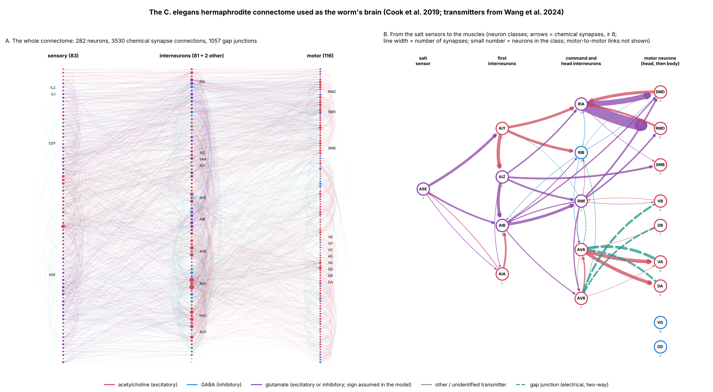
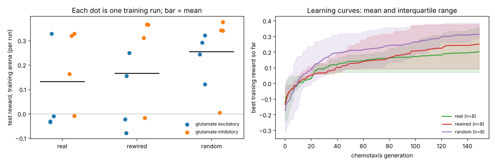

# wormbrain

Can the *C. elegans* connectome, used as a fixed-wiring neural network, learn to
steer a simulated worm up a chemical gradient? And does the real wiring do better
than rewired or random wiring with exactly the same number of trained parameters?

This project scales down the idea of FlyGM (Jin, Zhu, Zhang & Sui 2026,
[arXiv:2602.17997](https://arxiv.org/abs/2602.17997)), which used the whole fruit-fly
connectome as a fixed graph inside a body controller, to the 302-neuron worm.
Unlike FlyGM it trains with evolution strategies rather than deep RL, and it runs
on a laptop CPU.

**Status: milestone 6 of 8.** The real connectome, with only its neuron parameters
trained, learns to crawl and to climb a salt gradient to food using its salt sensors.
**In the pre-registered comparison it did not learn better than rewired or random
wiring;** random wiring did best (not significantly). Lesion study next.

## Plan

1. ~~Research data sources and agree the plan~~
2. ~~Connectome loader, sign assignment, control graphs, graph statistics~~
3. ~~2D worm body (resistive force theory) and arena, driven by a hand-coded oscillator~~
4. ~~Graded leaky-integrator brain on the connectome, wired to body and sensors; stability tests~~
5. ~~CMA-ES training on the real connectome until the worm reaches the food~~
6. ~~Control conditions, multi-seed experiments, `make report`~~
7. Lesion study compared with published ablations (Iino & Yoshida 2009; Gray et al. 2005)
8. In-browser demo on GitHub Pages

## Design in brief

- **Graph (fixed):** Cook et al. 2019 hermaphrodite chemical synapses and gap
  junctions, 282 non-pharyngeal neurons, with signs from the Wang et al. 2024
  neurotransmitter atlas. See [DATA.md](DATA.md) for every source and assumption.
- **Readout (fixed):** the real neuron→muscle synapses from the same dataset map
  motor neurons onto 95 body-wall muscles, so the readout is biological rather than learned.
- **Brain:** one graded leaky-integrator unit per neuron with a slow adaptation
  current (`src/wormbrain/brain.py`). Inputs: ASEL as a salt ON cell and ASER as an
  OFF cell; VB/DB motor neurons sense body curvature.
- **Trained:** time constant, bias, gain and adaptation strength per neuron class
  (104 classes), plus 9 global values (chemical and gap-junction scales, sensor and
  muscle gains, time constants): 425 parameters, identical for every graph.
- **Controls:** degree-preserving rewiring, an Erdős–Rényi graph, shuffled signs and
  shuffled weights. Only neuron-to-neuron wiring changes; inputs, outputs and the
  parameter count stay identical (`src/wormbrain/controls.py`).
- **Body:** 16 rigid segments on a plane (the worm lies on its side, so dorsal/ventral
  bends are in the plane), moved by resistive force theory with no inertia: each step
  solves for the motion that makes drag force and torque vanish. Muscle activations
  in the connectome's own layout (4 quadrants × 24 rows) set the target curvature
  (`src/wormbrain/body.py`).
- **Arena:** open plane with a Gaussian peak, several peaks or a linear gradient;
  random start 4–6 mm from food, random heading; reward = concentration gained
  (`src/wormbrain/env.py`, `configs/env*.yaml`).

## Setup

```bash
uv sync                     # Python 3.11+, installs cect and the rest
uv run pytest               # tests (first run builds the data cache, ~20 s)
make stats                  # graph statistics -> reports/graph_stats/
make oscillator             # body sanity checks -> reports/oscillator/ (~1 min)
```

## Layout

```
src/wormbrain/   data.py (load + cache) · signs.py · connectome.py · controls.py · graphstats.py
                 body.py · env.py · controllers.py
configs/         YAML configs (connectome.yaml holds every data assumption)
scripts/         command-line entry points
notebooks/       exploratory notebooks
reports/         generated figures and tables
tests/           pytest suite
```

## The wiring



`scripts/connectome_figure.py`. Left: every neuron and connection. Right: the circuit
from the salt sensors (ASE) to the muscles, by neuron class.

## Graph statistics so far

From [`reports/graph_stats/graph_stats.md`](reports/graph_stats/graph_stats.md):
the real graph has far more reciprocal connections (36% of edges vs 7% after
degree-preserving rewiring) and clustering (0.32 vs 0.15) than its controls. One
caveat for the comparison: in rewired and random graphs nearly every sensory neuron
connects directly to a motor neuron, against 73 of 83 (88%) in the real graph,
which could make the controls *easier* to train on a simple task.

## Body sanity checks

From [`reports/oscillator/oscillator.md`](reports/oscillator/oscillator.md): a
hand-coded head-to-tail bending wave (0.4 Hz) crawls forward at 0.18 mm/s, close to real
worms on agar; reversing the wave reverses the worm; a dorsal or ventral bias turns
it in mirror-image circles. With equal drag in all directions the worm cannot move,
the textbook result for this physics, and the tests check it. A crude hand-coded
steering rule (turn while concentration falls) ends 3.2 mm from food on average versus
20.7 mm for blind crawling, so the reward measures what it should. 32 worms × 120 s
simulate in about 8 s on one CPU core.

## Locomotion: first attempt failed, adaptation added

Before chemotaxis, the brain must make the body crawl. Trained only to crawl forward
(CMA-ES, 200 generations), the first brain model reached 0.009 mm/s, about 5% of the
hand-coded wave: the network settled to fixed states and the body froze in a bent
posture. A wider search, inhibitory glutamate and a random graph all failed the
same way ([`reports/locomotion/`](reports/locomotion/)), so the neuron model, not the
wiring, was the limit. Each neuron now has a slow adaptation current (a standard
mechanism for turning steady states into rhythms), adding 105 parameters. In a
one-seed prototype a random graph then crawled at 0.21 mm/s while the real
connectome still stalled.

## Locomotion study (3 seeds per cell)

From [`reports/locomotion_study/summary.md`](reports/locomotion_study/summary.md),
crawling forward for 30 s, 100 generations of CMA-ES, 425 parameters everywhere:

| graph | glutamate excitatory: crawled / mean speed | glutamate inhibitory: crawled / mean speed |
|---|---|---|
| real | 1/3, 0.04 mm/s | 2/3, 0.20 mm/s |
| rewired | 3/3, 0.27 mm/s | 1/3, 0.13 mm/s |
| random | 3/3, 0.26 mm/s | 1/3, 0.20 mm/s |

- **Go:** the real connectome can learn to crawl, with a head-to-tail bending wave
  (the direction of real forward crawling) in every run that moved.
- With glutamate treated as excitatory (the default) the real wiring learned worse than
  both controls in this small sample; with glutamate inhibitory there is no clear
  difference. The sign assumption matters more for the real graph than for the
  controls, which receive the same signs shuffled.
- Outcomes are close to all-or-nothing per seed (a run either finds a rhythm or
  stalls), so 3 seeds cannot settle anything: the chemotaxis comparison needs more
  seeds and generations.
- Several fast gaits undulate at 1.4–2.3 Hz, faster than real crawling; the body
  model has no energy cost or force limit to stop this.

## Chemotaxis training (milestone 5)

Two stages for every graph: learn to crawl, then learn chemotaxis
(`src/wormbrain/chemotaxis.py`, `configs/chemotaxis.yaml`).

- **First pilot failed: the worms learned to stop.** With a reward of concentration
  gained, crawling without steering scored −0.3 to −0.5 (on average it leads away
  from food) while stopping scored 0, so the search switched crawling off.
- **Fix, applied to every graph:** worms must keep moving (penalty below 0.1 mm/s
  path speed; real worms keep crawling during chemotaxis), the score averages the
  concentration over the second half of the episode, and each candidate is scored
  on 8 shared random starts over 90 s. [`reports/reward_check.md`](reports/reward_check.md)
  confirms that hand-coded steering now beats circling by 3x the evaluation noise.
- **Time step 0.02 s** for chemotaxis (crawling stage 0.01 s) to halve the cost.
  Against a 0.005 s reference, trained crawlers' speeds change by 5–20% and a
  hand-coded steerer's final distance by about 6%; all graphs use the same step.

- **Second pilot (real graph, 2 seeds x 2 glutamate settings): no chemotaxis.**
  Worms kept moving and circled, but scored −0.07 to −0.01 on the test set versus
  +0.08 for hand-coded steering ([`reports/chemotaxis_pilot/`](reports/chemotaxis_pilot/)).
  Clamping the salt neurons on changed nothing downstream
  ([`signal_trace.txt`](reports/chemotaxis_pilot/signal_trace.txt)): one brain had
  scaled its chemical synapses down to 0.01 and crawled on gap junctions alone, with
  its salt neurons saturated; in another the signal faded within two synapses
  through near-zero gains. The crawling stage never rewards sensing, so it is free
  to close the sensory pathway that chemotaxis later needs. A brain that can switch
  its chemical wiring off also defeats the real-versus-random comparison.

- **Two model changes fixed it** (approved before running; both apply to every graph):
  every parameter now stays in a plausible range, so a brain cannot scale its
  chemical synapses to nothing; and transmitter release is a tanh around a resting
  level instead of a 0-to-1 sigmoid. With the sigmoid, the large resting release
  turned every synapse into a constant drive and a salt signal reached a head motor
  neuron in 0% of random brains; with tanh, in 92%
  ([`reports/sensory_reach.md`](reports/sensory_reach.md)).
- **Third pilot (real graph, 2 seeds x 2 glutamate settings): chemotaxis learned.**
  On 32 held-out starts, three of four worms climbed the gradient from every start and
  ended 0.5–1.2 mm from the food (the best within 1 mm in 91% of starts), scoring
  +0.32 to +0.33 against +0.08 for hand-coded steering. They also did well in arenas
  never used in training (far starts, two peaks, a linear gradient). The fourth run's
  crawling stage failed (0.03 mm/s) and it never moved properly
  ([`reports/chemotaxis_pilot_tanh/`](reports/chemotaxis_pilot_tanh/summary.md)).
- **They really use their salt sensors:** with ASEL and ASER silenced, the same brains
  circle in place and climb only at chance
  ([`sensor_lesion.md`](reports/chemotaxis_pilot_tanh/sensor_lesion.md)). With the
  sensors they straighten out while concentration rises and loop around the food.
- Crawling with the new model is also more realistic: 0.36–0.72 Hz undulation.
- Training cost: about 70 minutes per run on one CPU core (6 min crawling, 66 min
  chemotaxis), four runs in parallel on a 4-core machine.

## Main result: real vs rewired vs random wiring (milestone 6)

Pre-registered in [ANALYSIS_PLAN.md](ANALYSIS_PLAN.md) before any comparison run;
full report in [`reports/comparison/RESULTS.md`](reports/comparison/RESULTS.md)
(`make report`). 3 graphs x 4 seeds x 2 glutamate settings = 24 runs, identical
parameters (425), training and budget; outcome = mean test reward over 32 held-out
starts.

| graph | mean test reward | runs reaching food | real − graph (95% CI) | Holm p |
|---|---|---|---|---|
| real | +0.131 | 2/8 | — | — |
| rewired | +0.165 | 2/8 | −0.034 [−0.172, +0.113] | 0.68 |
| random | +0.255 | 5/8 | −0.123 [−0.247, +0.012] | 0.25 |

- **The real wiring did not outperform either control.** No difference is
  significant. Numerically the random graph is highest in the training arena and in
  all three unseen arenas; the real graph is lowest in three of the four (in the
  linear gradient it edges the rewired graph, +0.10 vs +0.08).
- Outcomes are close to all-or-nothing per run: a run either finds a steering
  solution (test reward about +0.3) or does not (about 0). Real: 4/8 runs climbed;
  rewired 5/8; random 7/8.
- Every run that clearly climbed (16 runs, test reward above +0.1), in every graph, uses
  its salt sensors: silencing ASEL and ASER drops climbing to chance
  ([`sensor_lesion.md`](reports/comparison/sensor_lesion.md)).
- What this does and does not show: with 8 runs per graph only large differences are
  detectable, so this is "no detectable advantage", not proof that wiring is
  irrelevant. It is also a test of this model: graded point neurons with tied
  parameters per class, transmitter-based signs, a 2D body and a short training
  budget. The known confound runs against the real graph: in rewired and random
  graphs nearly every sensory neuron connects directly to a motor neuron (88% in
  the real graph), which may make them easier to train.



## Interactive page

[`web/dist/index.html`](web/dist/index.html) (also on
[alexbaker0.github.io/wormbrain](https://alexbaker0.github.io/wormbrain/)) runs the
best trained real, rewired and random brains live in the browser: tap anywhere to
move the food and watch the worm turn towards it, or silence its salt sensors.
`web/sim.js` is a plain JavaScript port of the brain and body; `tests/test_web.py`
checks it against Python step for step (largest difference about 1e-12 over 120 s of
simulated time). Rebuild with `make web`.

## Trained worms circle (found after milestone 6)

Watching the interactive page showed the worms move in loops, mostly turning one
way. [`reports/turning/turning.md`](reports/turning/turning.md)
(`scripts/turning_analysis.py`) confirms it for every graph: on a flat field each
successful brain turns one way 100% of the time, at 10–45°/s in circles 0.2–0.9 mm
across. The side differs between brains, so it is not one built-in bias; each brain
settles with one muscle side (dorsal or ventral, i.e. left or right on the plate)
slightly more active, driven mostly by the motor neurons that differ between the two
sides (13 VD vs 6 DD; AS reach dorsal muscles only). Turning hardly differs between
rising and falling concentration, so the worms reach food by loops that drift up
the gradient, not by the straight runs, pirouettes and weathervaning of real
C. elegans. The cause is the reward: with movement required, circling scored 0
while untargeted straight crawling scored about −0.5, so training found circling
first and only had to make it drift.

### Task v2 pilot (straightness penalty, faster-approach reward)

[`configs/chemotaxis_straight.yaml`](configs/chemotaxis_straight.yaml), real graph,
2 seeds x 2 glutamate settings ([`reports/chemotaxis_straight_pilot/`](reports/chemotaxis_straight_pilot/summary.md)):

- All four brains now crawl roughly straight on a flat field (0.6–5.9°/s, was 10–45°/s).
- One of four learned chemotaxis, and its paths look like real worms: fairly straight
  runs with turns, converging on the food (test reward +0.22 vs +0.06 for hand-coded
  steering; climbed from 91% of starts; also good in unseen arenas). Silencing its
  salt sensors abolishes this.
- The other three exposed two loopholes: one crawls in wide circles slow enough to stay
  under the 10°/s limit (turning is measured per second, not per millimetre), and one
  wiggles on the spot, which the minimum-speed rule counts as movement because it
  measures the centroid's path length, jitter included.

### Task v3 pilot (loopholes closed)

[`configs/chemotaxis_straight2.yaml`](configs/chemotaxis_straight2.yaml): straightness
per mm of progress, minimum speed from net progress. All four brains crawl straight
(4–16°/mm) and keep moving, but none learned chemotaxis (test reward −0.03 to −0.00,
climbing at chance; [`reports/chemotaxis_straight2_pilot/`](reports/chemotaxis_straight2_pilot/summary.md)).
The population settled on straight blind crawling within a few dozen generations and
the search narrowed there: a penalty on turning from the first generation blocks the
route to steering, which seems to pass through brains that turn a lot before turning
is tied to smell.

### Natural rewards (overnight study)

Instead of a straightness penalty, the same four real-connectome brains were
fine-tuned under five "natural" rewards: fast approach, time spent eating, net energy,
food that moves, and far food with more time; all scored on one common set of tests
([`reports/natural_rewards/REPORT.md`](reports/natural_rewards/REPORT.md)). Rewarding
fast approach alone keeps chemotaxis but does not remove circling; moving food and far
food loosen circling most (mean turning 177 → 84 and 64°/mm) while keeping 75% of worms
reaching the food and improving re-finding of moved food (35% → 56–70%). Circling is a
property of particular brains: one brain circles under every reward, while another
becomes a fast straight steerer under almost all of them (best: 2°/mm, food reached
from every start in a median 47 s, moved food re-found 94% of the time). Forcing
straightness costs chemotaxis (35% reach food); a high energy cost destroys it (14%).

## Limitations (so far)

- Synapse signs are inferred from transmitter identity; glutamate's sign is a
  global assumption that changes the excitatory:inhibitory ratio from 16:1 to 2:1.
- Connection weights are anatomical, not physiological strengths.
- Neuromodulation (monoamines, neuropeptides) is left out.
- The body's shape is set by the muscles alone (no passive bending from the
  environment), there are no walls, and the agar drag ratio (20) is an assumption;
  only the ratio matters for the motion and it is a config option.
- Left and right muscles in each dorsal/ventral pair act together, since the body is 2D.
- Trained worms move in drifting loops, not the straight runs and turns of real worms
  (see above).
- Nothing limits undulation frequency except the muscle time constant and the energy
  penalty; trained gaits can be faster than real worms'.
- The milestone-4 locomotion study used the earlier model (sigmoid, unbounded); its
  numbers do not describe the current one. Crawling under the current model is
  measured in every chemotaxis run's first stage.
