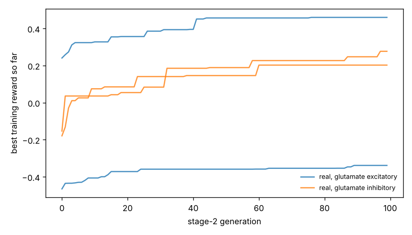

# Chemotaxis results

Test set: 32 fixed starts per arena, never used in training. Reward = mean concentration over the second half minus the start (fraction of peak), minus 0.05 x mean power, minus 0.5 x max(0, 1 - path speed / 0.1 mm/s). 'Concentration gain' leaves out both penalties. 'reached' = ends within 1 mm of the main peak.

## gaussian

| graph | glutamate | seeds | reward per seed | reward mean | concentration gain | reached 1 mm | crawl speed after stage 1 (mm/s) |
|---|---|---|---|---|---|---|---|
| real | excitatory | 2 | -0.369, +0.393 | +0.012 | +0.205 | 12% | 0.03, 0.25 |
| real | inhibitory | 2 | -0.013, +0.145 | +0.066 | +0.080 | 2% | 0.50, 0.29 |
| *blind crawling* | — | — | — | -0.099 | -0.096 | 0% | — |
| *gradient steering* | — | — | — | +0.059 | +0.083 | 0% | — |

## far_start

| graph | glutamate | seeds | reward per seed | reward mean | concentration gain | reached 1 mm | crawl speed after stage 1 (mm/s) |
|---|---|---|---|---|---|---|---|
| real | excitatory | 2 | -0.363, +0.618 | +0.127 | +0.320 | 23% | 0.03, 0.25 |
| real | inhibitory | 2 | +0.062, +0.295 | +0.179 | +0.192 | 0% | 0.50, 0.29 |
| *blind crawling* | — | — | — | +0.021 | +0.024 | 0% | — |
| *gradient steering* | — | — | — | +0.092 | +0.110 | 0% | — |

## two_peaks

| graph | glutamate | seeds | reward per seed | reward mean | concentration gain | reached 1 mm | crawl speed after stage 1 (mm/s) |
|---|---|---|---|---|---|---|---|
| real | excitatory | 2 | -0.368, +0.369 | +0.001 | +0.194 | 16% | 0.03, 0.25 |
| real | inhibitory | 2 | -0.007, +0.122 | +0.057 | +0.071 | 3% | 0.50, 0.29 |
| *blind crawling* | — | — | — | -0.096 | -0.093 | 0% | — |
| *gradient steering* | — | — | — | +0.079 | +0.105 | 3% | — |

## linear

| graph | glutamate | seeds | reward per seed | reward mean | concentration gain | reached 1 mm | crawl speed after stage 1 (mm/s) |
|---|---|---|---|---|---|---|---|
| real | excitatory | 2 | -0.357, +0.251 | -0.053 | +0.141 | nan% | 0.03, 0.25 |
| real | inhibitory | 2 | -0.024, +0.147 | +0.062 | +0.075 | nan% | 0.50, 0.29 |
| *blind crawling* | — | — | — | -0.036 | -0.033 | nan% | — |
| *gradient steering* | — | — | — | +0.203 | +0.208 | nan% | — |

