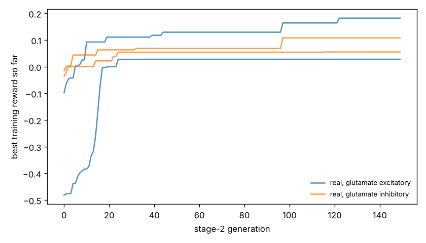

# Chemotaxis results

Test set: 32 fixed starts per arena, never used in training. Reward = mean concentration over the second half minus the start (fraction of peak), minus 0.05 x mean power, minus 0.5 x max(0, 1 - path speed / 0.1 mm/s). 'Concentration gain' leaves out both penalties. 'reached' = ends within 1 mm of the main peak.

## gaussian

| graph | glutamate | seeds | reward per seed | reward mean | concentration gain | reached 1 mm | crawl speed after stage 1 (mm/s) |
|---|---|---|---|---|---|---|---|
| real | excitatory | 2 | -0.009, -0.069 | -0.039 | -0.028 | 0% | 0.01, 0.11 |
| real | inhibitory | 2 | -0.030, -0.009 | -0.019 | -0.006 | 0% | 0.05, 0.15 |
| *blind crawling* | — | — | — | -0.533 | -0.530 | 0% | — |
| *gradient steering* | — | — | — | +0.076 | +0.108 | 0% | — |

## far_start

| graph | glutamate | seeds | reward per seed | reward mean | concentration gain | reached 1 mm | crawl speed after stage 1 (mm/s) |
|---|---|---|---|---|---|---|---|
| real | excitatory | 2 | -0.008, -0.042 | -0.025 | -0.014 | 0% | 0.01, 0.11 |
| real | inhibitory | 2 | -0.019, -0.016 | -0.017 | -0.005 | 0% | 0.05, 0.15 |
| *blind crawling* | — | — | — | -0.199 | -0.196 | 0% | — |
| *gradient steering* | — | — | — | +0.188 | +0.210 | 0% | — |

## two_peaks

| graph | glutamate | seeds | reward per seed | reward mean | concentration gain | reached 1 mm | crawl speed after stage 1 (mm/s) |
|---|---|---|---|---|---|---|---|
| real | excitatory | 2 | -0.009, -0.065 | -0.037 | -0.026 | 0% | 0.01, 0.11 |
| real | inhibitory | 2 | -0.029, -0.009 | -0.019 | -0.006 | 0% | 0.05, 0.15 |
| *blind crawling* | — | — | — | -0.502 | -0.499 | 0% | — |
| *gradient steering* | — | — | — | +0.075 | +0.106 | 0% | — |

## linear

| graph | glutamate | seeds | reward per seed | reward mean | concentration gain | reached 1 mm | crawl speed after stage 1 (mm/s) |
|---|---|---|---|---|---|---|---|
| real | excitatory | 2 | -0.008, -0.007 | -0.008 | +0.003 | nan% | 0.01, 0.11 |
| real | inhibitory | 2 | -0.007, -0.018 | -0.013 | -0.000 | nan% | 0.05, 0.15 |
| *blind crawling* | — | — | — | -0.053 | -0.050 | nan% | — |
| *gradient steering* | — | — | — | +0.325 | +0.331 | nan% | — |

