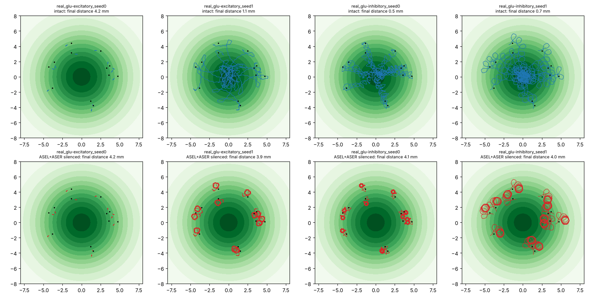

# Do trained worms use their salt sensors?

Generated by `scripts/chemotaxis_figure.py --results reports/chemotaxis_pilot_tanh`. Test starts (32) in the training arena; the same trained parameters with ASEL and ASER silenced. Concentration gain leaves out the energy and idle penalties.

| run | gain, intact | climbed, intact | final distance (mm), intact | gain, sensors silenced | climbed, silenced | final distance (mm), silenced |
|---|---|---|---|---|---|---|
| real_glu-excitatory_seed0 | -0.007 | 47% | 4.16 | -0.005 | 38% | 4.16 |
| real_glu-excitatory_seed1 | +0.347 | 100% | 1.15 | -0.001 | 47% | 3.94 |
| real_glu-inhibitory_seed0 | +0.340 | 100% | 0.47 | -0.007 | 47% | 4.05 |
| real_glu-inhibitory_seed1 | +0.354 | 100% | 0.73 | +0.004 | 50% | 3.98 |

