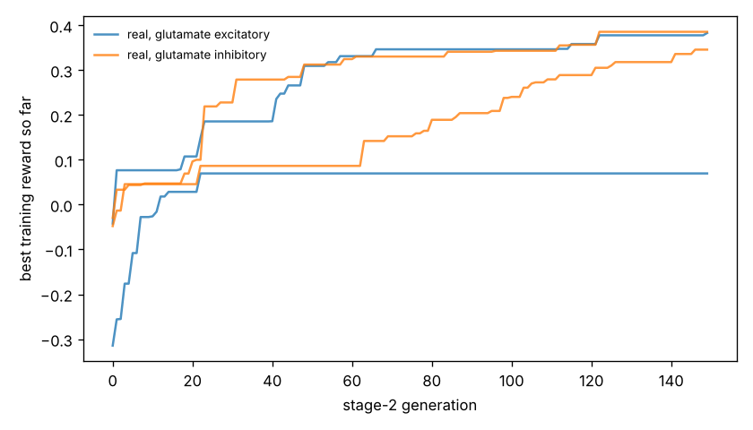

# Chemotaxis results

Test set: 32 fixed starts per arena, never used in training. Reward = mean concentration over the second half minus the start (fraction of peak), minus 0.05 x mean power, minus 0.5 x max(0, 1 - path speed / 0.1 mm/s). 'Concentration gain' leaves out both penalties. 'reached' = ends within 1 mm of the main peak.

## gaussian

| graph | glutamate | seeds | reward per seed | reward mean | concentration gain | reached 1 mm | crawl speed after stage 1 (mm/s) |
|---|---|---|---|---|---|---|---|
| real | excitatory | 2 | -0.010, +0.327 | +0.158 | +0.170 | 16% | 0.03, 0.25 |
| real | inhibitory | 2 | +0.319, +0.328 | +0.323 | +0.347 | 91% | 0.50, 0.29 |
| *blind crawling* | — | — | — | -0.533 | -0.530 | 0% | — |
| *gradient steering* | — | — | — | +0.076 | +0.108 | 0% | — |

## far_start

| graph | glutamate | seeds | reward per seed | reward mean | concentration gain | reached 1 mm | crawl speed after stage 1 (mm/s) |
|---|---|---|---|---|---|---|---|
| real | excitatory | 2 | -0.009, +0.522 | +0.257 | +0.268 | 16% | 0.03, 0.25 |
| real | inhibitory | 2 | +0.597, +0.690 | +0.643 | +0.667 | 58% | 0.50, 0.29 |
| *blind crawling* | — | — | — | -0.199 | -0.196 | 0% | — |
| *gradient steering* | — | — | — | +0.188 | +0.210 | 0% | — |

## two_peaks

| graph | glutamate | seeds | reward per seed | reward mean | concentration gain | reached 1 mm | crawl speed after stage 1 (mm/s) |
|---|---|---|---|---|---|---|---|
| real | excitatory | 2 | -0.010, +0.318 | +0.154 | +0.166 | 16% | 0.03, 0.25 |
| real | inhibitory | 2 | +0.306, +0.317 | +0.312 | +0.336 | 88% | 0.50, 0.29 |
| *blind crawling* | — | — | — | -0.502 | -0.499 | 0% | — |
| *gradient steering* | — | — | — | +0.075 | +0.106 | 0% | — |

## linear

| graph | glutamate | seeds | reward per seed | reward mean | concentration gain | reached 1 mm | crawl speed after stage 1 (mm/s) |
|---|---|---|---|---|---|---|---|
| real | excitatory | 2 | -0.002, +0.258 | +0.128 | +0.140 | nan% | 0.03, 0.25 |
| real | inhibitory | 2 | +0.179, +0.409 | +0.294 | +0.318 | nan% | 0.50, 0.29 |
| *blind crawling* | — | — | — | -0.053 | -0.050 | nan% | — |
| *gradient steering* | — | — | — | +0.325 | +0.331 | nan% | — |

