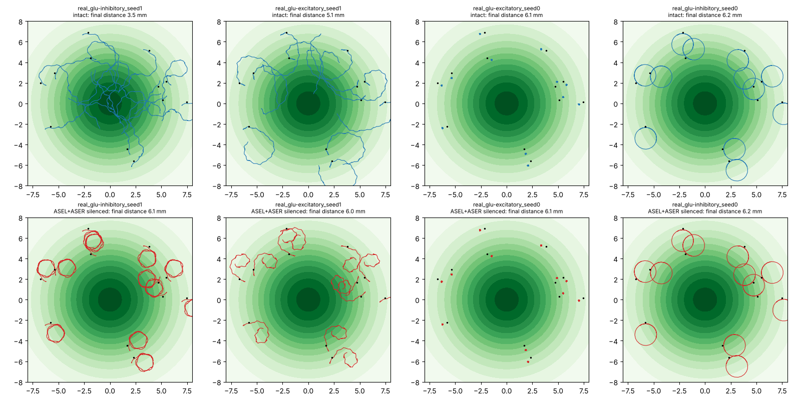

# Do trained worms use their salt sensors?

Generated by `scripts/chemotaxis_figure.py --results reports/chemotaxis_straight_pilot`. Test starts (32) in the training arena; the same trained parameters with ASEL and ASER silenced. Concentration gain leaves out the energy and idle penalties.

| run | gain, intact | climbed, intact | final distance (mm), intact | gain, sensors silenced | climbed, silenced | final distance (mm), silenced |
|---|---|---|---|---|---|---|
| real_glu-excitatory_seed0 | -0.001 | 44% | 6.06 | -0.001 | 38% | 6.06 |
| real_glu-excitatory_seed1 | +0.049 | 47% | 5.14 | -0.002 | 53% | 6.02 |
| real_glu-inhibitory_seed0 | -0.017 | 38% | 6.25 | -0.016 | 38% | 6.23 |
| real_glu-inhibitory_seed1 | +0.242 | 91% | 3.48 | -0.010 | 50% | 6.13 |

