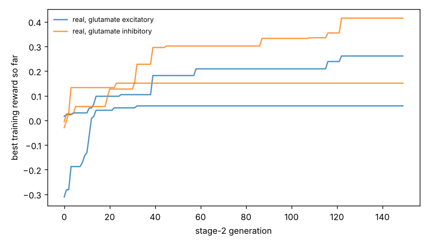

# Chemotaxis results

Test set: 32 fixed starts per arena, never used in training. Reward = mean concentration over the second half minus the start (fraction of peak), minus 0.05 x mean power, minus 0.5 x max(0, 1 - path speed / 0.1 mm/s). 'Concentration gain' leaves out both penalties. 'reached' = ends within 1 mm of the main peak.

## gaussian

| graph | glutamate | seeds | reward per seed | reward mean | concentration gain | reached 1 mm | crawl speed after stage 1 (mm/s) |
|---|---|---|---|---|---|---|---|
| real | excitatory | 2 | -0.004, +0.032 | +0.014 | +0.024 | 0% | 0.03, 0.25 |
| real | inhibitory | 2 | -0.020, +0.221 | +0.101 | +0.113 | 2% | 0.50, 0.29 |
| *blind crawling* | — | — | — | -0.099 | -0.096 | 0% | — |
| *gradient steering* | — | — | — | +0.059 | +0.083 | 0% | — |

## far_start

| graph | glutamate | seeds | reward per seed | reward mean | concentration gain | reached 1 mm | crawl speed after stage 1 (mm/s) |
|---|---|---|---|---|---|---|---|
| real | excitatory | 2 | -0.003, +0.091 | +0.044 | +0.053 | 0% | 0.03, 0.25 |
| real | inhibitory | 2 | -0.003, +0.301 | +0.149 | +0.161 | 5% | 0.50, 0.29 |
| *blind crawling* | — | — | — | +0.021 | +0.024 | 0% | — |
| *gradient steering* | — | — | — | +0.092 | +0.110 | 0% | — |

## two_peaks

| graph | glutamate | seeds | reward per seed | reward mean | concentration gain | reached 1 mm | crawl speed after stage 1 (mm/s) |
|---|---|---|---|---|---|---|---|
| real | excitatory | 2 | -0.004, +0.035 | +0.015 | +0.025 | 0% | 0.03, 0.25 |
| real | inhibitory | 2 | -0.020, +0.209 | +0.095 | +0.107 | 3% | 0.50, 0.29 |
| *blind crawling* | — | — | — | -0.096 | -0.093 | 0% | — |
| *gradient steering* | — | — | — | +0.079 | +0.105 | 3% | — |

## linear

| graph | glutamate | seeds | reward per seed | reward mean | concentration gain | reached 1 mm | crawl speed after stage 1 (mm/s) |
|---|---|---|---|---|---|---|---|
| real | excitatory | 2 | -0.003, -0.013 | -0.008 | +0.002 | nan% | 0.03, 0.25 |
| real | inhibitory | 2 | -0.005, +0.270 | +0.132 | +0.144 | nan% | 0.50, 0.29 |
| *blind crawling* | — | — | — | -0.036 | -0.033 | nan% | — |
| *gradient steering* | — | — | — | +0.203 | +0.208 | nan% | — |

