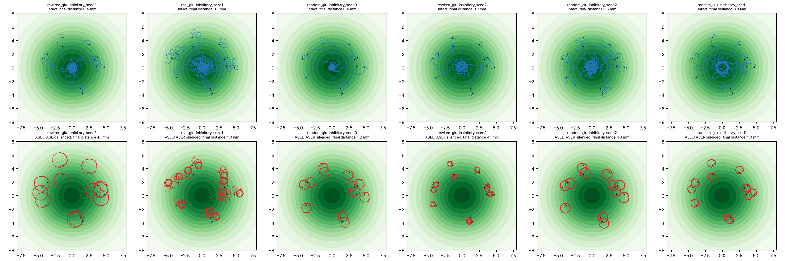

# Do trained worms use their salt sensors?

Generated by `scripts/chemotaxis_figure.py --results reports/comparison`. Test starts (32) in the training arena; the same trained parameters with ASEL and ASER silenced. Concentration gain leaves out the energy and idle penalties.

| run | gain, intact | climbed, intact | final distance (mm), intact | gain, sensors silenced | climbed, silenced | final distance (mm), silenced |
|---|---|---|---|---|---|---|
| random_glu-excitatory_seed0 | +0.339 | 100% | 0.83 | -0.019 | 44% | 4.25 |
| random_glu-excitatory_seed1 | +0.311 | 100% | 0.84 | -0.000 | 50% | 3.95 |
| random_glu-excitatory_seed2 | +0.132 | 100% | 2.64 | -0.013 | 41% | 3.95 |
| random_glu-excitatory_seed3 | +0.262 | 100% | 1.52 | -0.196 | 31% | 6.26 |
| random_glu-inhibitory_seed0 | +0.385 | 100% | 0.35 | -0.017 | 38% | 4.20 |
| random_glu-inhibitory_seed1 | +0.362 | 100% | 0.85 | -0.001 | 50% | 4.04 |
| random_glu-inhibitory_seed2 | +0.372 | 100% | 0.64 | -0.016 | 31% | 3.96 |
| random_glu-inhibitory_seed3 | +0.017 | 53% | 3.90 | +0.016 | 53% | 3.90 |
| real_glu-excitatory_seed0 | -0.007 | 47% | 4.16 | -0.005 | 38% | 4.16 |
| real_glu-excitatory_seed1 | +0.347 | 100% | 1.15 | -0.001 | 47% | 3.94 |
| real_glu-excitatory_seed2 | -0.025 | 38% | 4.08 | -0.027 | 38% | 4.09 |
| real_glu-excitatory_seed3 | -0.024 | 38% | 4.07 | -0.023 | 38% | 4.07 |
| real_glu-inhibitory_seed0 | +0.340 | 100% | 0.47 | -0.007 | 47% | 4.05 |
| real_glu-inhibitory_seed1 | +0.354 | 100% | 0.73 | +0.004 | 50% | 3.98 |
| real_glu-inhibitory_seed2 | +0.174 | 100% | 2.32 | -0.013 | 38% | 4.01 |
| real_glu-inhibitory_seed3 | -0.004 | 44% | 3.95 | -0.004 | 44% | 3.96 |
| rewired_glu-excitatory_seed0 | +0.000 | 53% | 3.98 | -0.017 | 47% | 4.12 |
| rewired_glu-excitatory_seed1 | +0.170 | 88% | 2.34 | +0.012 | 56% | 3.98 |
| rewired_glu-excitatory_seed2 | +0.260 | 100% | 1.78 | -0.318 | 19% | 8.62 |
| rewired_glu-excitatory_seed3 | -0.017 | 47% | 4.17 | -0.019 | 41% | 4.12 |
| rewired_glu-inhibitory_seed0 | +0.330 | 100% | 1.15 | -0.008 | 50% | 3.91 |
| rewired_glu-inhibitory_seed1 | -0.011 | 34% | 4.01 | -0.016 | 31% | 4.06 |
| rewired_glu-inhibitory_seed2 | +0.376 | 100% | 0.66 | -0.008 | 44% | 4.10 |
| rewired_glu-inhibitory_seed3 | +0.382 | 100% | 0.41 | -0.010 | 47% | 4.06 |

