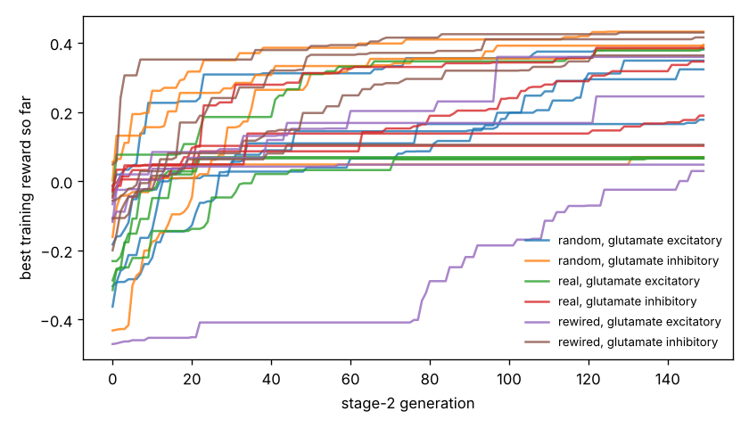

# Chemotaxis results

Test set: 32 fixed starts per arena, never used in training. Reward = mean concentration over the second half minus the start (fraction of peak), minus 0.05 x mean power, minus 0.5 x max(0, 1 - path speed / 0.1 mm/s). 'Concentration gain' leaves out both penalties. 'reached' = ends within 1 mm of the main peak.

## gaussian

| graph | glutamate | seeds | reward per seed | reward mean | concentration gain | reached 1 mm | crawl speed after stage 1 (mm/s) |
|---|---|---|---|---|---|---|---|
| random | excitatory | 4 | +0.320, +0.291, +0.120, +0.243 | +0.244 | +0.261 | 40% | 0.10, 0.02, 0.04, 0.01 |
| random | inhibitory | 4 | +0.376, +0.341, +0.342, +0.003 | +0.265 | +0.284 | 75% | 0.13, 0.17, 0.43, 0.02 |
| real | excitatory | 4 | -0.010, +0.327, -0.032, -0.034 | +0.063 | +0.073 | 8% | 0.03, 0.25, 0.03, 0.03 |
| real | inhibitory | 4 | +0.319, +0.328, +0.163, -0.009 | +0.200 | +0.216 | 45% | 0.50, 0.29, 0.22, 0.20 |
| rewired | excitatory | 4 | -0.080, +0.155, +0.249, -0.024 | +0.075 | +0.103 | 5% | 0.01, 0.08, 0.10, 0.06 |
| rewired | inhibitory | 4 | +0.310, -0.017, +0.364, +0.365 | +0.256 | +0.269 | 54% | 0.26, 0.07, 0.06, 0.16 |
| *blind crawling* | — | — | — | -0.533 | -0.530 | 0% | — |
| *gradient steering* | — | — | — | +0.076 | +0.108 | 0% | — |

## far_start

| graph | glutamate | seeds | reward per seed | reward mean | concentration gain | reached 1 mm | crawl speed after stage 1 (mm/s) |
|---|---|---|---|---|---|---|---|
| random | excitatory | 4 | +0.692, +0.511, +0.154, +0.395 | +0.438 | +0.456 | 29% | 0.10, 0.02, 0.04, 0.01 |
| random | inhibitory | 4 | +0.758, +0.711, +0.694, +0.023 | +0.546 | +0.565 | 75% | 0.13, 0.17, 0.43, 0.02 |
| real | excitatory | 4 | -0.009, +0.522, -0.013, -0.011 | +0.122 | +0.132 | 8% | 0.03, 0.25, 0.03, 0.03 |
| real | inhibitory | 4 | +0.597, +0.690, +0.232, -0.005 | +0.378 | +0.394 | 29% | 0.50, 0.29, 0.22, 0.20 |
| rewired | excitatory | 4 | -0.015, +0.314, +0.405, -0.014 | +0.173 | +0.200 | 5% | 0.01, 0.08, 0.10, 0.06 |
| rewired | inhibitory | 4 | +0.710, -0.006, +0.734, +0.749 | +0.547 | +0.560 | 50% | 0.26, 0.07, 0.06, 0.16 |
| *blind crawling* | — | — | — | -0.199 | -0.196 | 0% | — |
| *gradient steering* | — | — | — | +0.188 | +0.210 | 0% | — |

## two_peaks

| graph | glutamate | seeds | reward per seed | reward mean | concentration gain | reached 1 mm | crawl speed after stage 1 (mm/s) |
|---|---|---|---|---|---|---|---|
| random | excitatory | 4 | +0.306, +0.282, +0.115, +0.231 | +0.234 | +0.251 | 39% | 0.10, 0.02, 0.04, 0.01 |
| random | inhibitory | 4 | +0.363, +0.328, +0.329, +0.004 | +0.256 | +0.275 | 75% | 0.13, 0.17, 0.43, 0.02 |
| real | excitatory | 4 | -0.010, +0.318, -0.030, -0.032 | +0.061 | +0.072 | 8% | 0.03, 0.25, 0.03, 0.03 |
| real | inhibitory | 4 | +0.306, +0.317, +0.155, -0.009 | +0.192 | +0.209 | 44% | 0.50, 0.29, 0.22, 0.20 |
| rewired | excitatory | 4 | -0.078, +0.144, +0.236, -0.023 | +0.070 | +0.098 | 5% | 0.01, 0.08, 0.10, 0.06 |
| rewired | inhibitory | 4 | +0.293, -0.017, +0.352, +0.353 | +0.245 | +0.259 | 54% | 0.26, 0.07, 0.06, 0.16 |
| *blind crawling* | — | — | — | -0.502 | -0.499 | 0% | — |
| *gradient steering* | — | — | — | +0.075 | +0.106 | 0% | — |

## linear

| graph | glutamate | seeds | reward per seed | reward mean | concentration gain | reached 1 mm | crawl speed after stage 1 (mm/s) |
|---|---|---|---|---|---|---|---|
| random | excitatory | 4 | +0.004, +0.037, +0.037, +0.113 | +0.048 | +0.065 | nan% | 0.10, 0.02, 0.04, 0.01 |
| random | inhibitory | 4 | +0.607, +0.358, +0.142, -0.016 | +0.273 | +0.291 | nan% | 0.13, 0.17, 0.43, 0.02 |
| real | excitatory | 4 | -0.002, +0.258, -0.003, -0.006 | +0.062 | +0.072 | nan% | 0.03, 0.25, 0.03, 0.03 |
| real | inhibitory | 4 | +0.179, +0.409, -0.005, -0.004 | +0.145 | +0.161 | nan% | 0.50, 0.29, 0.22, 0.20 |
| rewired | excitatory | 4 | -0.075, +0.011, +0.267, -0.004 | +0.050 | +0.078 | nan% | 0.01, 0.08, 0.10, 0.06 |
| rewired | inhibitory | 4 | +0.103, -0.005, +0.146, +0.157 | +0.100 | +0.114 | nan% | 0.26, 0.07, 0.06, 0.16 |
| *blind crawling* | — | — | — | -0.053 | -0.050 | nan% | — |
| *gradient steering* | — | — | — | +0.325 | +0.331 | nan% | — |

