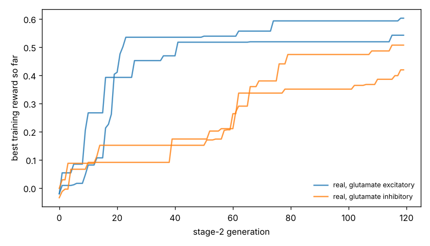

# Chemotaxis results

Test set: 32 fixed starts per arena, never used in training. Reward = mean concentration over the second half minus the start (fraction of peak), minus 0.05 x mean power, minus 0.5 x max(0, 1 - path speed / 0.1 mm/s). 'Concentration gain' leaves out both penalties. 'reached' = ends within 1 mm of the main peak.

## gaussian

| graph | glutamate | seeds | reward per seed | reward mean | concentration gain | reached 1 mm | crawl speed after stage 1 (mm/s) |
|---|---|---|---|---|---|---|---|
| real | excitatory | 2 | +0.543, +0.454 | +0.499 | +0.525 | 72% | 0.38, 0.24 |
| real | inhibitory | 2 | +0.314, +0.443 | +0.379 | +0.403 | 42% | 0.13, 0.42 |
| *blind crawling* | — | — | — | -0.159 | -0.156 | 0% | — |
| *gradient steering* | — | — | — | +0.091 | +0.116 | 0% | — |

## far_start

| graph | glutamate | seeds | reward per seed | reward mean | concentration gain | reached 1 mm | crawl speed after stage 1 (mm/s) |
|---|---|---|---|---|---|---|---|
| real | excitatory | 2 | +0.749, +0.648 | +0.699 | +0.725 | 75% | 0.38, 0.24 |
| real | inhibitory | 2 | +0.441, +0.613 | +0.527 | +0.551 | 44% | 0.13, 0.42 |
| *blind crawling* | — | — | — | +0.021 | +0.024 | 0% | — |
| *gradient steering* | — | — | — | +0.092 | +0.110 | 0% | — |

