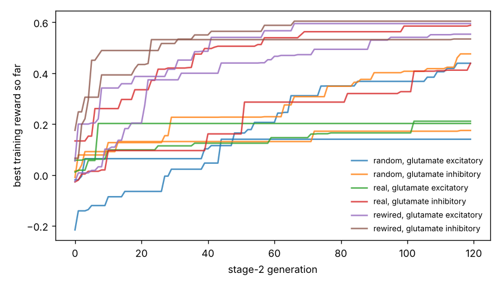

# Chemotaxis results

Test set: 32 fixed starts per arena, never used in training. Reward = mean concentration over the second half minus the start (fraction of peak), minus 0.05 x mean power, minus 0.5 x max(0, 1 - path speed / 0.1 mm/s). 'Concentration gain' leaves out both penalties. 'reached' = ends within 1 mm of the main peak.

## gaussian

| graph | glutamate | seeds | reward per seed | reward mean | concentration gain | reached 1 mm | crawl speed after stage 1 (mm/s) |
|---|---|---|---|---|---|---|---|
| random | excitatory | 2 | +0.355, -0.031 | +0.162 | +0.176 | 23% | 0.12, 0.07 |
| random | inhibitory | 2 | +0.014, +0.403 | +0.209 | +0.237 | 50% | 0.11, 0.15 |
| real | excitatory | 2 | +0.099, -0.022 | +0.038 | +0.046 | 0% | 0.33, 0.19 |
| real | inhibitory | 2 | +0.385, +0.509 | +0.447 | +0.486 | 53% | 0.33, 0.37 |
| rewired | excitatory | 2 | +0.494, +0.527 | +0.511 | +0.554 | 100% | 0.36, 0.31 |
| rewired | inhibitory | 2 | +0.464, +0.534 | +0.499 | +0.545 | 95% | 0.43, 0.30 |
| *blind crawling* | — | — | — | -0.159 | -0.156 | 0% | — |
| *gradient steering* | — | — | — | +0.091 | +0.116 | 0% | — |

## far_start

| graph | glutamate | seeds | reward per seed | reward mean | concentration gain | reached 1 mm | crawl speed after stage 1 (mm/s) |
|---|---|---|---|---|---|---|---|
| random | excitatory | 2 | +0.486, -0.011 | +0.238 | +0.252 | 22% | 0.12, 0.07 |
| random | inhibitory | 2 | +0.011, +0.573 | +0.292 | +0.320 | 48% | 0.11, 0.15 |
| real | excitatory | 2 | +0.106, -0.009 | +0.049 | +0.056 | 0% | 0.33, 0.19 |
| real | inhibitory | 2 | +0.559, +0.709 | +0.634 | +0.673 | 34% | 0.33, 0.37 |
| rewired | excitatory | 2 | +0.681, +0.721 | +0.701 | +0.744 | 100% | 0.36, 0.31 |
| rewired | inhibitory | 2 | +0.638, +0.738 | +0.688 | +0.735 | 100% | 0.43, 0.30 |
| *blind crawling* | — | — | — | +0.021 | +0.024 | 0% | — |
| *gradient steering* | — | — | — | +0.092 | +0.110 | 0% | — |

