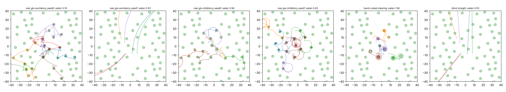

# Curriculum: crawl → steer up a broad gradient → patch world

Both bodies have head proprioception (SMD/RMD sense head bending) and the back/belly
offset. **Symmetric** also ties the dorsal/ventral motor classes (VA=DA, VB=DB, VD=DD);
**usual** does not. Stages:

1. Crawling: 100 generations.
2. Broad-gradient chemotaxis: 120 generations, reward = concentration − energy, with the
   keep-moving rule.
3. Patch world v2: 100 generations, reward = food eaten − energy and nothing else.

Configs are `configs/curr_{usual,sym}_{grad,patch}.yaml`; the run script is
`scripts/queue_curriculum.sh`. Seeds 0–1, both glutamate settings.

## Held-out test: food eaten in 12 minutes (32 starts)

| run | usual | symmetric |
|---|---|---|
| excitatory, seed 0 | 0.79 | **5.65** |
| inhibitory, seed 0 | 0.58 | **4.39** |
| excitatory, seed 1 | 2.91 | 0.69 |
| inhibitory, seed 1 | 3.78 | **5.09** |
| mean | 2.02 | **3.96** |

Reference points:

- hand-coded steering: 1.89
- blind straight crawling: 0.77
- best brain from any earlier experiment: 3.38 (far-food steerer)
- patch v2 with no curriculum: 1.77 mean
- symmetric body without the curriculum: 0.60 mean

## How they move (16 worms, test layout)

Symmetric:

| mover | food eaten (12 min) | speed on food (mm/s) | speed far from food | time on food | turning far from food, °/mm (one-way share) | turning near food, °/mm |
|---|---|---|---|---|---|---|
| real_glu-excitatory_seed0 | 5.74 | 0.289 | 0.309 | 28% | 16 (61%) | 59 |
| real_glu-excitatory_seed1 | 0.53 | 0.113 | 0.112 | 2% | 55 (15%) | 51 |
| real_glu-inhibitory_seed0 | 3.94 | 0.115 | 0.125 | 21% | 235 (6%) | 268 |
| real_glu-inhibitory_seed1 | 5.03 | 0.366 | 0.276 | 34% | 12 (77%) | 63 |
| hand-coded steering | 1.56 | 0.140 | 0.176 | 17% | 28 (59%) | 69 |
| blind straight | 0.53 | 0.176 | 0.176 | 2% | 20 (0%) | 20 |

Usual:

| mover | food eaten (12 min) | speed on food (mm/s) | speed far from food | time on food | turning far from food, °/mm (one-way share) | turning near food, °/mm |
|---|---|---|---|---|---|---|
| real_glu-excitatory_seed0 | 0.77 | 0.100 | 0.100 | 4% | 347 (3%) | 329 |
| real_glu-excitatory_seed1 | 2.83 | 0.169 | 0.179 | 14% | 141 (3%) | 184 |
| real_glu-inhibitory_seed0 | 0.55 | 0.064 | 0.064 | 3% | 66 (7%) | 51 |
| real_glu-inhibitory_seed1 | 3.28 | 0.278 | 0.265 | 17% | 63 (100%) | 62 |
| hand-coded steering | 1.56 | 0.140 | 0.176 | 17% | 28 (59%) | 69 |
| blind straight | 0.53 | 0.176 | 0.176 | 2% | 20 (0%) | 20 |

## Do they steer? (fake rising/falling smell; `steering.md`)

The steering response is how much more the worm turns while the smell falls than while it
rises (°/s). Hand-coded steering scores −17.9. Symmetric brains score −19.4 (excitatory
seed 0), −6.1 (inhibitory seed 0), −4.0 (inhibitory seed 1) and 0.0 (excitatory seed 1, the
non-steerer).

Smell reach (`smell_reach.md`): in the best brain the smell now reaches the head motor
neurons strongly. SMDD shows 2.27 of smell-locked activity, against 0.04 in the symmetric
brains trained without the curriculum.

## What we learn

1. **The behaviour you expected appears with food minus energy as the only final reward.**
   The best brain (symmetric, excitatory seed 0) crawls in straight runs from patch to
   patch and stops briefly to eat at each one. It eats 5.65 patches, three times the
   hand-coded steerer. It turns only 2.3°/mm on an empty field and crawls at 0.3 mm/s.
2. **What made it possible:**
   - **A body that crawls straight by default.** Tied D/V classes plus the offset make the
     back and belly balanced.
   - **Head neurons that know which way the head is bending**, so steering can depend on
     the head's phase.
   - **A first stage where the smell is present everywhere.** This trains the pathway from
     the smell sensors to the head motor neurons before the sparse patch world.

   Without the curriculum, the symmetric body crawled straight but never learned to steer.
3. **The symmetric body was more reliable than the usual body:** 3 of 4 brains became
   strong foragers, against 2 of 4. Mean food eaten was 3.96 against 2.02. With four runs
   each, this is suggestive, not conclusive.
4. **Remaining imperfections:**
   - Excitatory seed 1 crawls straight but never learned to steer.
   - Inhibitory seed 1 makes wide loops between patches (77% one-way turning far from food).
   - The patch stage costs some of the broad-gradient skill (climbing 44–100%).
