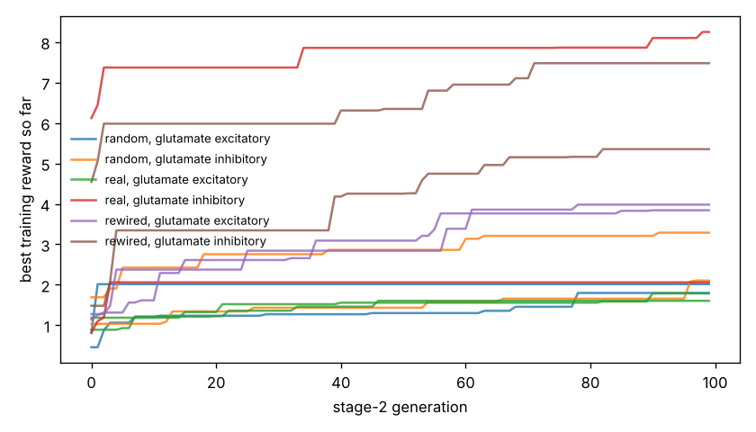

# Chemotaxis results

Test set: 32 fixed starts per arena, never used in training. Reward = mean concentration over the second half minus the start (fraction of peak), minus 0.05 x mean power, minus 0.5 x max(0, 1 - path speed / 0.1 mm/s). 'Concentration gain' leaves out both penalties. 'reached' = ends within 1 mm of the main peak.

## patches

| graph | glutamate | seeds | reward per seed | reward mean | concentration gain | reached 1 mm | crawl speed after stage 1 (mm/s) |
|---|---|---|---|---|---|---|---|
| random | excitatory | 2 | +1.326, +0.498 | +0.912 | +0.952 | nan% | 0.12, 0.07 |
| random | inhibitory | 2 | +1.057, +2.854 | +1.955 | +2.068 | nan% | 0.11, 0.15 |
| real | excitatory | 2 | +0.641, +0.602 | +0.621 | +0.674 | nan% | 0.33, 0.19 |
| real | inhibitory | 2 | +1.045, +7.203 | +4.124 | +4.294 | nan% | 0.33, 0.37 |
| rewired | excitatory | 2 | +3.372, +2.363 | +2.867 | +3.003 | nan% | 0.36, 0.31 |
| rewired | inhibitory | 2 | +6.796, +4.845 | +5.820 | +6.033 | nan% | 0.43, 0.30 |
| *blind crawling* | — | — | — | +0.761 | +0.772 | nan% | — |
| *gradient steering* | — | — | — | +1.724 | +1.886 | nan% | — |

## gaussian

| graph | glutamate | seeds | reward per seed | reward mean | concentration gain | reached 1 mm | crawl speed after stage 1 (mm/s) |
|---|---|---|---|---|---|---|---|
| random | excitatory | 2 | -0.060, +0.015 | -0.022 | -0.010 | 0% | 0.12, 0.07 |
| random | inhibitory | 2 | +0.026, -0.104 | -0.039 | -0.010 | 2% | 0.11, 0.15 |
| real | excitatory | 2 | +0.015, -0.025 | -0.005 | +0.009 | 0% | 0.33, 0.19 |
| real | inhibitory | 2 | +0.272, +0.444 | +0.358 | +0.401 | 14% | 0.33, 0.37 |
| rewired | excitatory | 2 | +0.355, +0.398 | +0.377 | +0.409 | 56% | 0.36, 0.31 |
| rewired | inhibitory | 2 | +0.408, -0.115 | +0.146 | +0.203 | 17% | 0.43, 0.30 |
| *blind crawling* | — | — | — | -0.099 | -0.096 | 0% | — |
| *gradient steering* | — | — | — | +0.059 | +0.083 | 0% | — |

