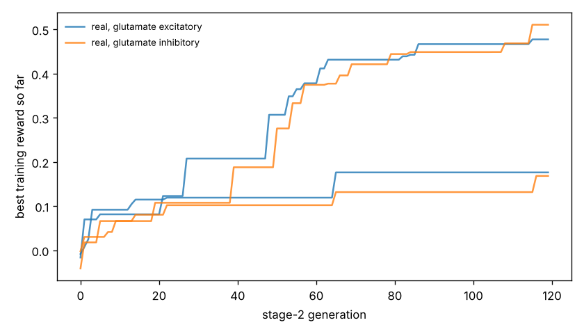

# Chemotaxis results

Test set: 32 fixed starts per arena, never used in training. Reward = mean concentration over the second half minus the start (fraction of peak), minus 0.05 x mean power, minus 0.5 x max(0, 1 - path speed / 0.1 mm/s). 'Concentration gain' leaves out both penalties. 'reached' = ends within 1 mm of the main peak.

## gaussian

| graph | glutamate | seeds | reward per seed | reward mean | concentration gain | reached 1 mm | crawl speed after stage 1 (mm/s) |
|---|---|---|---|---|---|---|---|
| real | excitatory | 2 | -0.012, +0.425 | +0.207 | +0.225 | 9% | 0.15, 0.19 |
| real | inhibitory | 2 | -0.025, +0.421 | +0.198 | +0.216 | 23% | 0.15, 0.46 |
| *blind crawling* | — | — | — | -0.159 | -0.156 | 0% | — |
| *gradient steering* | — | — | — | +0.091 | +0.116 | 0% | — |

## far_start

| graph | glutamate | seeds | reward per seed | reward mean | concentration gain | reached 1 mm | crawl speed after stage 1 (mm/s) |
|---|---|---|---|---|---|---|---|
| real | excitatory | 2 | +0.062, +0.555 | +0.309 | +0.327 | 25% | 0.15, 0.19 |
| real | inhibitory | 2 | +0.016, +0.559 | +0.288 | +0.305 | 25% | 0.15, 0.46 |
| *blind crawling* | — | — | — | +0.021 | +0.024 | 0% | — |
| *gradient steering* | — | — | — | +0.092 | +0.110 | 0% | — |

