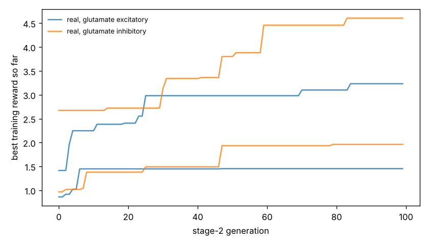

# Chemotaxis results

Test set: 32 fixed starts per arena, never used in training. Reward = mean concentration over the second half minus the start (fraction of peak), minus 0.05 x mean power, minus 0.5 x max(0, 1 - path speed / 0.1 mm/s). 'Concentration gain' leaves out both penalties. 'reached' = ends within 1 mm of the main peak.

## patches

| graph | glutamate | seeds | reward per seed | reward mean | concentration gain | reached 1 mm | crawl speed after stage 1 (mm/s) |
|---|---|---|---|---|---|---|---|
| real | excitatory | 2 | +0.752, +2.787 | +1.770 | +1.851 | nan% | 0.15, 0.19 |
| real | inhibitory | 2 | +0.570, +3.684 | +2.127 | +2.177 | nan% | 0.15, 0.46 |
| *blind crawling* | — | — | — | +0.761 | +0.772 | nan% | — |
| *gradient steering* | — | — | — | +1.724 | +1.886 | nan% | — |

## gaussian

| graph | glutamate | seeds | reward per seed | reward mean | concentration gain | reached 1 mm | crawl speed after stage 1 (mm/s) |
|---|---|---|---|---|---|---|---|
| real | excitatory | 2 | +0.010, +0.173 | +0.091 | +0.113 | 9% | 0.15, 0.19 |
| real | inhibitory | 2 | +0.037, +0.318 | +0.178 | +0.192 | 22% | 0.15, 0.46 |
| *blind crawling* | — | — | — | -0.099 | -0.096 | 0% | — |
| *gradient steering* | — | — | — | +0.059 | +0.083 | 0% | — |

