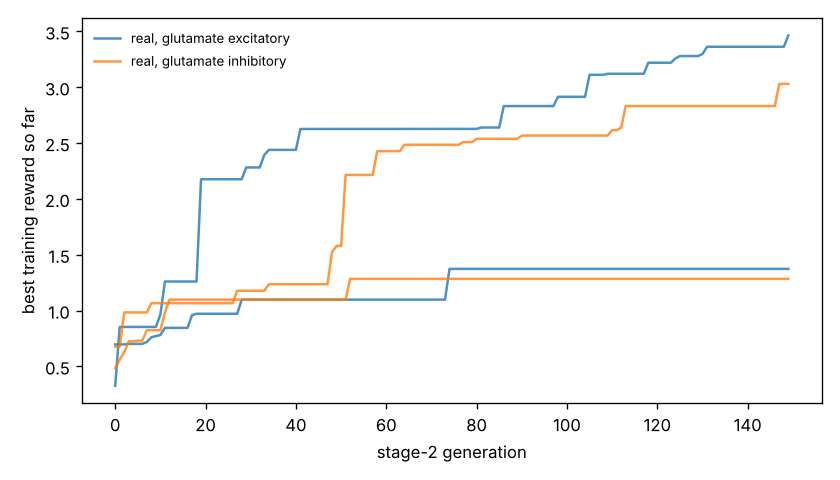

# Chemotaxis results

Test set: 32 fixed starts per arena, never used in training. Reward = mean concentration over the second half minus the start (fraction of peak), minus 0.05 x mean power, minus 0.5 x max(0, 1 - path speed / 0.1 mm/s). 'Concentration gain' leaves out both penalties. 'reached' = ends within 1 mm of the main peak.

## forage

| graph | glutamate | seeds | reward per seed | reward mean | concentration gain | reached 1 mm | crawl speed after stage 1 (mm/s) |
|---|---|---|---|---|---|---|---|
| real | excitatory | 2 | +3.147, +0.491 | +1.819 | +1.929 | nan% | 0.09, 0.23 |
| real | inhibitory | 2 | +0.560, +2.463 | +1.512 | +1.595 | nan% | 0.18, 0.20 |
| *blind crawling* | — | — | — | +0.220 | +0.231 | nan% | — |
| *gradient steering* | — | — | — | +0.491 | +0.607 | nan% | — |

## gaussian

| graph | glutamate | seeds | reward per seed | reward mean | concentration gain | reached 1 mm | crawl speed after stage 1 (mm/s) |
|---|---|---|---|---|---|---|---|
| real | excitatory | 2 | +0.348, -0.071 | +0.138 | +0.167 | 44% | 0.09, 0.23 |
| real | inhibitory | 2 | -0.024, +0.403 | +0.190 | +0.210 | 41% | 0.18, 0.20 |
| *blind crawling* | — | — | — | -0.099 | -0.096 | 0% | — |
| *gradient steering* | — | — | — | +0.059 | +0.083 | 0% | — |

