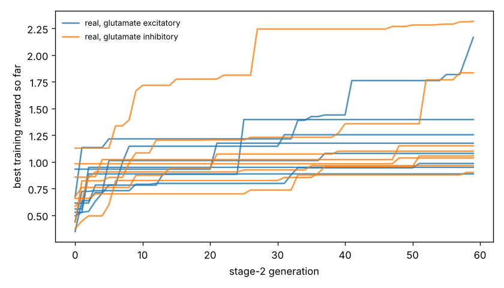

# Chemotaxis results

Test set: 32 fixed starts per arena, never used in training. Reward = mean concentration over the second half minus the start (fraction of peak), minus 0.05 x mean power, minus 0.5 x max(0, 1 - path speed / 0.1 mm/s). 'Concentration gain' leaves out both penalties. 'reached' = ends within 1 mm of the main peak.

## forage

| graph | glutamate | seeds | reward per seed | reward mean | concentration gain | reached 1 mm | crawl speed after stage 1 (mm/s) |
|---|---|---|---|---|---|---|---|
| real | excitatory | 8 | +0.832, +2.039, +1.107, +0.549, +0.470, +0.478, +0.260, +0.555 | +0.786 | +0.913 | nan% | 0.20, 0.05, 0.22, 0.12, 0.21, 0.14, 0.22, 0.22 |
| real | inhibitory | 8 | +0.558, +2.356, +0.567, +0.605, +0.894, +0.505, +2.186, +0.271 | +0.993 | +1.088 | nan% | 0.16, 0.21, 0.24, 0.19, 0.21, 0.23, 0.21, 0.20 |
| *blind crawling* | — | — | — | +0.220 | +0.231 | nan% | — |
| *gradient steering* | — | — | — | +0.477 | +0.593 | nan% | — |

## gaussian

| graph | glutamate | seeds | reward per seed | reward mean | concentration gain | reached 1 mm | crawl speed after stage 1 (mm/s) |
|---|---|---|---|---|---|---|---|
| real | excitatory | 8 | +0.047, +0.262, +0.046, -0.111, -0.049, -0.036, -0.122, -0.072 | -0.004 | +0.028 | 9% | 0.20, 0.05, 0.22, 0.12, 0.21, 0.14, 0.22, 0.22 |
| real | inhibitory | 8 | -0.035, +0.376, -0.058, -0.058, -0.105, +0.006, +0.344, -0.003 | +0.058 | +0.083 | 10% | 0.16, 0.21, 0.24, 0.19, 0.21, 0.23, 0.21, 0.20 |
| *blind crawling* | — | — | — | -0.099 | -0.096 | 0% | — |
| *gradient steering* | — | — | — | +0.059 | +0.083 | 0% | — |

