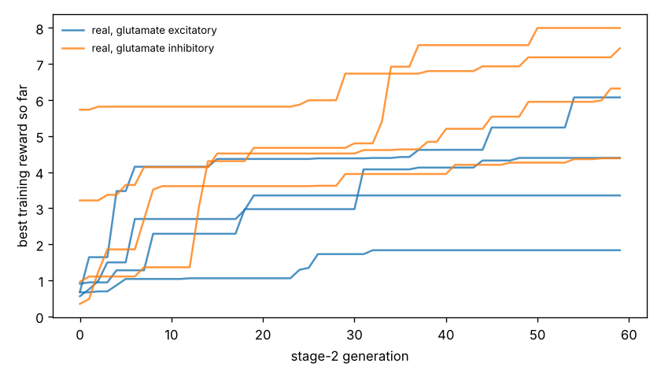

# Chemotaxis results

Test set: 32 fixed starts per arena, never used in training. Reward = mean concentration over the second half minus the start (fraction of peak), minus 0.05 x mean power, minus 0.5 x max(0, 1 - path speed / 0.1 mm/s). 'Concentration gain' leaves out both penalties. 'reached' = ends within 1 mm of the main peak.

## forage

| graph | glutamate | seeds | reward per seed | reward mean | concentration gain | reached 1 mm | crawl speed after stage 1 (mm/s) |
|---|---|---|---|---|---|---|---|
| real | excitatory | 4 | +3.641, +5.565, +1.318, +1.451 | +2.994 | +3.059 | nan% | 0.22, 0.20, 0.23, 0.16 |
| real | inhibitory | 4 | +6.266, +7.862, +6.666, +4.139 | +6.233 | +6.439 | nan% | 0.21, 0.24, 0.21, 0.22 |
| *blind crawling* | — | — | — | +0.220 | +0.231 | nan% | — |
| *gradient steering* | — | — | — | +0.576 | +0.690 | nan% | — |

## gaussian

| graph | glutamate | seeds | reward per seed | reward mean | concentration gain | reached 1 mm | crawl speed after stage 1 (mm/s) |
|---|---|---|---|---|---|---|---|
| real | excitatory | 4 | +0.194, +0.374, +0.105, -0.033 | +0.160 | +0.178 | 12% | 0.22, 0.20, 0.23, 0.16 |
| real | inhibitory | 4 | +0.368, +0.435, +0.366, +0.299 | +0.367 | +0.420 | 70% | 0.21, 0.24, 0.21, 0.22 |
| *blind crawling* | — | — | — | -0.099 | -0.096 | 0% | — |
| *gradient steering* | — | — | — | +0.059 | +0.083 | 0% | — |

