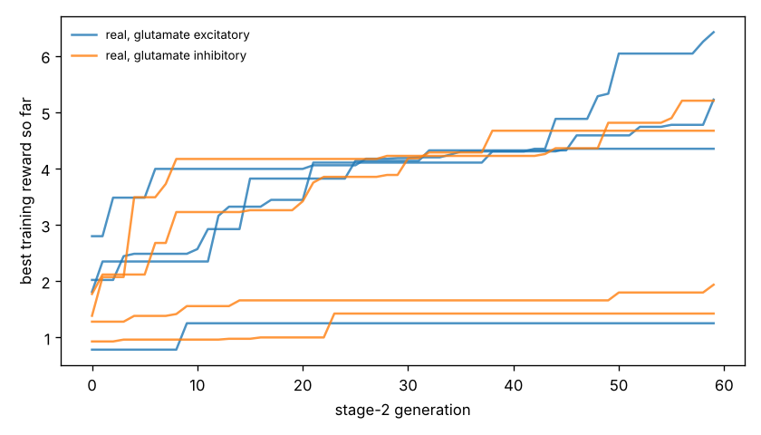

# Chemotaxis results

Test set: 32 fixed starts per arena, never used in training. Reward = mean concentration over the second half minus the start (fraction of peak), minus 0.05 x mean power, minus 0.5 x max(0, 1 - path speed / 0.1 mm/s). 'Concentration gain' leaves out both penalties. 'reached' = ends within 1 mm of the main peak.

## forage

| graph | glutamate | seeds | reward per seed | reward mean | concentration gain | reached 1 mm | crawl speed after stage 1 (mm/s) |
|---|---|---|---|---|---|---|---|
| real | excitatory | 4 | +4.223, +6.158, +0.390, +4.536 | +3.827 | +3.909 | nan% | 0.22, 0.20, 0.23, 0.16 |
| real | inhibitory | 4 | +4.237, +2.033, +5.033, +0.447 | +2.937 | +3.091 | nan% | 0.21, 0.24, 0.21, 0.22 |
| *blind crawling* | — | — | — | +0.220 | +0.231 | nan% | — |
| *gradient steering* | — | — | — | +0.576 | +0.692 | nan% | — |

## gaussian

| graph | glutamate | seeds | reward per seed | reward mean | concentration gain | reached 1 mm | crawl speed after stage 1 (mm/s) |
|---|---|---|---|---|---|---|---|
| real | excitatory | 4 | +0.291, +0.363, +0.021, +0.157 | +0.208 | +0.231 | 35% | 0.22, 0.20, 0.23, 0.16 |
| real | inhibitory | 4 | +0.244, +0.133, +0.368, +0.018 | +0.191 | +0.230 | 24% | 0.21, 0.24, 0.21, 0.22 |
| *blind crawling* | — | — | — | -0.099 | -0.096 | 0% | — |
| *gradient steering* | — | — | — | +0.059 | +0.083 | 0% | — |

