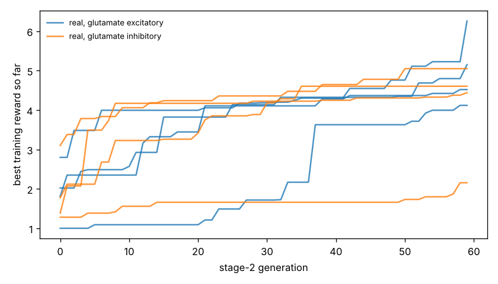

# Chemotaxis results

Test set: 32 fixed starts per arena, never used in training. Reward = mean concentration over the second half minus the start (fraction of peak), minus 0.05 x mean power, minus 0.5 x max(0, 1 - path speed / 0.1 mm/s). 'Concentration gain' leaves out both penalties. 'reached' = ends within 1 mm of the main peak.

## forage

| graph | glutamate | seeds | reward per seed | reward mean | concentration gain | reached 1 mm | crawl speed after stage 1 (mm/s) |
|---|---|---|---|---|---|---|---|
| real | excitatory | 4 | +4.195, +4.174, +5.941, +4.263 | +4.644 | +4.732 | nan% | 0.22, 0.22, 0.20, 0.16 |
| real | inhibitory | 4 | +3.914, +2.209, +4.270, +5.236 | +3.907 | +4.075 | nan% | 0.21, 0.24, 0.21, 0.19 |
| *blind crawling* | — | — | — | +0.220 | +0.231 | nan% | — |
| *gradient steering* | — | — | — | +0.576 | +0.692 | nan% | — |

## gaussian

| graph | glutamate | seeds | reward per seed | reward mean | concentration gain | reached 1 mm | crawl speed after stage 1 (mm/s) |
|---|---|---|---|---|---|---|---|
| real | excitatory | 4 | +0.236, +0.244, +0.372, +0.077 | +0.232 | +0.257 | 32% | 0.22, 0.22, 0.20, 0.16 |
| real | inhibitory | 4 | +0.222, +0.139, +0.347, +0.377 | +0.271 | +0.313 | 29% | 0.21, 0.24, 0.21, 0.19 |
| *blind crawling* | — | — | — | -0.099 | -0.096 | 0% | — |
| *gradient steering* | — | — | — | +0.059 | +0.083 | 0% | — |

