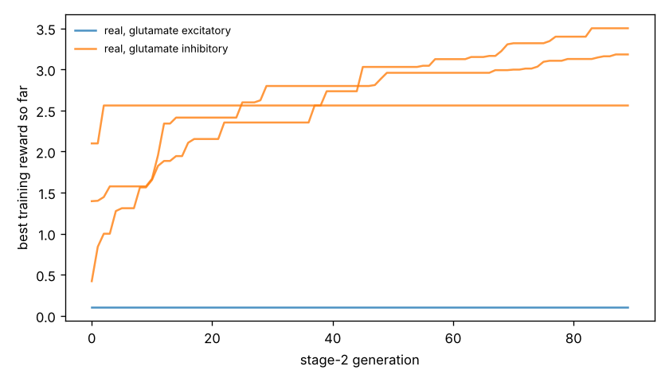

# Chemotaxis results

Test set: 32 fixed starts per arena, never used in training. Reward = mean concentration over the second half minus the start (fraction of peak), minus 0.05 x mean power, minus 0.5 x max(0, 1 - path speed / 0.1 mm/s). 'Concentration gain' leaves out both penalties. 'reached' = ends within 1 mm of the main peak.

## forage

| graph | glutamate | seeds | reward per seed | reward mean | concentration gain | reached 1 mm | crawl speed after stage 1 (mm/s) |
|---|---|---|---|---|---|---|---|
| real | excitatory | 1 | +0.338 | +0.338 | +1.331 | nan% | 0.20 |
| real | inhibitory | 3 | +3.093, +2.527, +3.428 | +3.016 | +3.880 | nan% | 0.21, 0.24, 0.21 |
| *blind crawling* | — | — | — | -0.112 | +0.000 | nan% | — |
| *gradient steering* | — | — | — | -1.187 | +0.000 | nan% | — |

## gaussian

| graph | glutamate | seeds | reward per seed | reward mean | concentration gain | reached 1 mm | crawl speed after stage 1 (mm/s) |
|---|---|---|---|---|---|---|---|
| real | excitatory | 1 | +0.207 | +0.207 | +0.232 | 3% | 0.20 |
| real | inhibitory | 3 | +0.307, +0.383, +0.304 | +0.331 | +0.353 | 81% | 0.21, 0.24, 0.21 |
| *blind crawling* | — | — | — | -0.099 | -0.096 | 0% | — |
| *gradient steering* | — | — | — | +0.059 | +0.083 | 0% | — |

