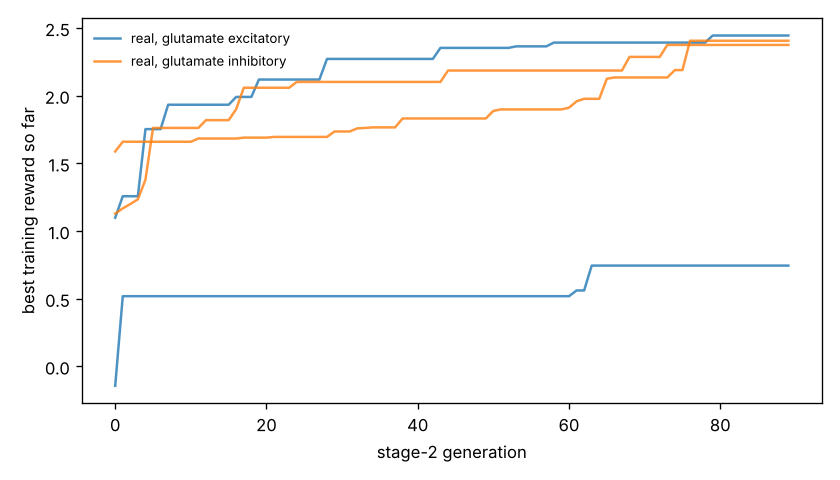

# Chemotaxis results

Test set: 32 fixed starts per arena, never used in training. Reward = mean concentration over the second half minus the start (fraction of peak), minus 0.05 x mean power, minus 0.5 x max(0, 1 - path speed / 0.1 mm/s). 'Concentration gain' leaves out both penalties. 'reached' = ends within 1 mm of the main peak.

## forage

| graph | glutamate | seeds | reward per seed | reward mean | concentration gain | reached 1 mm | crawl speed after stage 1 (mm/s) |
|---|---|---|---|---|---|---|---|
| real | excitatory | 2 | +2.070, +0.144 | +1.107 | +1.352 | nan% | 0.05, 0.22 |
| real | inhibitory | 2 | +1.871, +1.919 | +1.895 | +2.262 | nan% | 0.21, 0.21 |
| *blind crawling* | — | — | — | +0.152 | +0.208 | nan% | — |
| *gradient steering* | — | — | — | -0.007 | +0.587 | nan% | — |

## gaussian

| graph | glutamate | seeds | reward per seed | reward mean | concentration gain | reached 1 mm | crawl speed after stage 1 (mm/s) |
|---|---|---|---|---|---|---|---|
| real | excitatory | 2 | +0.390, +0.041 | +0.215 | +0.228 | 38% | 0.05, 0.22 |
| real | inhibitory | 2 | +0.325, +0.436 | +0.380 | +0.398 | 45% | 0.21, 0.21 |
| *blind crawling* | — | — | — | -0.099 | -0.096 | 0% | — |
| *gradient steering* | — | — | — | +0.059 | +0.083 | 0% | — |

