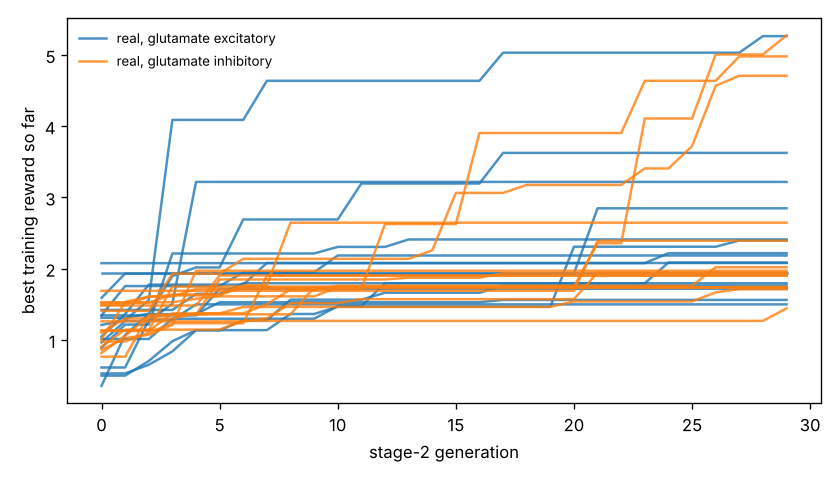

# Chemotaxis results

Test set: 32 fixed starts per arena, never used in training. Reward = mean concentration over the second half minus the start (fraction of peak), minus 0.05 x mean power, minus 0.5 x max(0, 1 - path speed / 0.1 mm/s). 'Concentration gain' leaves out both penalties. 'reached' = ends within 1 mm of the main peak.

## forage

| graph | glutamate | seeds | reward per seed | reward mean | concentration gain | reached 1 mm | crawl speed after stage 1 (mm/s) |
|---|---|---|---|---|---|---|---|
| real | excitatory | 16 | +1.662, +1.339, +1.829, +1.018, +1.232, +1.513, +0.680, +2.006, +0.721, +4.943, +2.133, +0.777, +1.284, +0.857, +1.333, +2.309 | +1.602 | +1.722 | nan% | 0.20, 0.05, 0.22, 0.12, 0.21, 0.14, 0.22, 0.22, 0.21, 0.20, 0.23, 0.21, -0.03, 0.20, 0.12, 0.16 |
| real | inhibitory | 16 | +0.963, +5.480, +2.491, +1.440, +0.773, +0.844, +4.963, +0.603, +0.924, +0.880, +1.453, +1.117, +1.358, +0.984, +0.846, +5.355 | +1.905 | +2.020 | nan% | 0.16, 0.21, 0.24, 0.19, 0.21, 0.23, 0.21, 0.20, 0.28, 0.21, 0.23, 0.17, 0.19, 0.18, 0.23, 0.22 |
| *blind crawling* | — | — | — | +0.256 | +0.267 | nan% | — |
| *gradient steering* | — | — | — | +1.170 | +1.354 | nan% | — |

## gaussian

| graph | glutamate | seeds | reward per seed | reward mean | concentration gain | reached 1 mm | crawl speed after stage 1 (mm/s) |
|---|---|---|---|---|---|---|---|
| real | excitatory | 16 | -0.010, -0.015, +0.002, -0.025, -0.071, -0.062, -0.094, +0.040, -0.080, +0.121, -0.000, -0.051, -0.050, -0.063, -0.019, -0.043 | -0.026 | +0.004 | 0% | 0.20, 0.05, 0.22, 0.12, 0.21, 0.14, 0.22, 0.22, 0.21, 0.20, 0.23, 0.21, -0.03, 0.20, 0.12, 0.16 |
| real | inhibitory | 16 | -0.079, +0.204, +0.019, -0.008, -0.007, -0.034, +0.202, -0.093, -0.079, -0.030, +0.003, -0.024, -0.001, -0.044, -0.036, +0.166 | +0.010 | +0.039 | 4% | 0.16, 0.21, 0.24, 0.19, 0.21, 0.23, 0.21, 0.20, 0.28, 0.21, 0.23, 0.17, 0.19, 0.18, 0.23, 0.22 |
| *blind crawling* | — | — | — | -0.099 | -0.096 | 0% | — |
| *gradient steering* | — | — | — | +0.059 | +0.083 | 0% | — |

