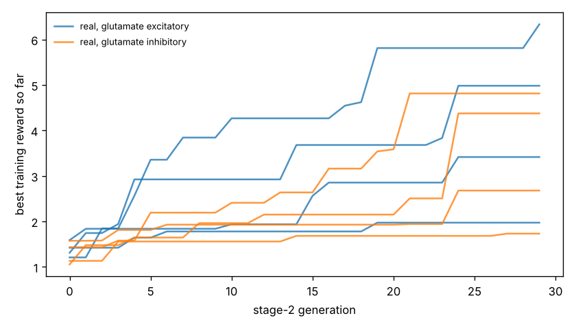

# Chemotaxis results

Test set: 32 fixed starts per arena, never used in training. Reward = mean concentration over the second half minus the start (fraction of peak), minus 0.05 x mean power, minus 0.5 x max(0, 1 - path speed / 0.1 mm/s). 'Concentration gain' leaves out both penalties. 'reached' = ends within 1 mm of the main peak.

## forage

| graph | glutamate | seeds | reward per seed | reward mean | concentration gain | reached 1 mm | crawl speed after stage 1 (mm/s) |
|---|---|---|---|---|---|---|---|
| real | excitatory | 4 | +3.059, +5.698, +0.769, +3.618 | +3.286 | +3.382 | nan% | 0.22, 0.20, 0.23, 0.16 |
| real | inhibitory | 4 | +4.826, +2.957, +4.110, +1.056 | +3.237 | +3.349 | nan% | 0.21, 0.24, 0.21, 0.22 |
| *blind crawling* | — | — | — | +0.256 | +0.267 | nan% | — |
| *gradient steering* | — | — | — | +0.891 | +1.092 | nan% | — |

## gaussian

| graph | glutamate | seeds | reward per seed | reward mean | concentration gain | reached 1 mm | crawl speed after stage 1 (mm/s) |
|---|---|---|---|---|---|---|---|
| real | excitatory | 4 | +0.032, +0.091, -0.001, -0.018 | +0.026 | +0.052 | 1% | 0.22, 0.20, 0.23, 0.16 |
| real | inhibitory | 4 | +0.062, +0.033, +0.090, -0.064 | +0.030 | +0.058 | 1% | 0.21, 0.24, 0.21, 0.22 |
| *blind crawling* | — | — | — | -0.099 | -0.096 | 0% | — |
| *gradient steering* | — | — | — | +0.059 | +0.083 | 0% | — |

