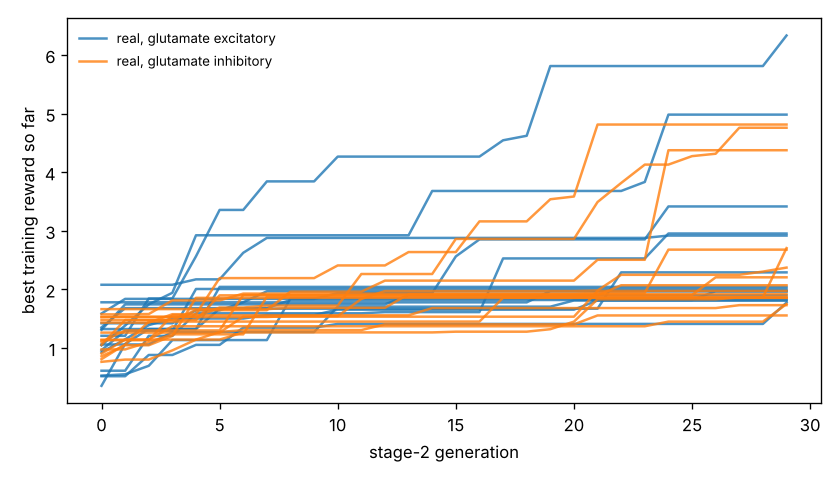

# Chemotaxis results

Test set: 32 fixed starts per arena, never used in training. Reward = mean concentration over the second half minus the start (fraction of peak), minus 0.05 x mean power, minus 0.5 x max(0, 1 - path speed / 0.1 mm/s). 'Concentration gain' leaves out both penalties. 'reached' = ends within 1 mm of the main peak.

## forage

| graph | glutamate | seeds | reward per seed | reward mean | concentration gain | reached 1 mm | crawl speed after stage 1 (mm/s) |
|---|---|---|---|---|---|---|---|
| real | excitatory | 16 | +1.927, +0.879, +2.450, +0.550, +0.890, +0.774, +0.900, +3.059, +0.928, +5.698, +0.769, +0.850, +0.704, +1.008, +1.107, +3.618 | +1.632 | +1.751 | nan% | 0.20, 0.05, 0.22, 0.12, 0.21, 0.14, 0.22, 0.22, 0.21, 0.20, 0.23, 0.21, -0.03, 0.20, 0.12, 0.16 |
| real | inhibitory | 16 | +0.963, +4.826, +2.957, +1.028, +0.410, +0.868, +4.110, +1.261, +0.579, +2.300, +1.933, +0.790, +4.911, +0.605, +0.744, +1.056 | +1.834 | +1.953 | nan% | 0.16, 0.21, 0.24, 0.19, 0.21, 0.23, 0.21, 0.20, 0.28, 0.21, 0.23, 0.17, 0.19, 0.18, 0.23, 0.22 |
| *blind crawling* | — | — | — | +0.256 | +0.267 | nan% | — |
| *gradient steering* | — | — | — | +0.891 | +1.092 | nan% | — |

## gaussian

| graph | glutamate | seeds | reward per seed | reward mean | concentration gain | reached 1 mm | crawl speed after stage 1 (mm/s) |
|---|---|---|---|---|---|---|---|
| real | excitatory | 16 | +0.006, -0.077, +0.056, -0.012, -0.015, +0.004, -0.099, +0.032, -0.035, +0.091, -0.001, -0.059, -0.032, -0.032, -0.039, -0.018 | -0.014 | +0.016 | 0% | 0.20, 0.05, 0.22, 0.12, 0.21, 0.14, 0.22, 0.22, 0.21, 0.20, 0.23, 0.21, -0.03, 0.20, 0.12, 0.16 |
| real | inhibitory | 16 | -0.079, +0.062, +0.033, -0.055, +0.001, -0.038, +0.090, -0.027, -0.056, +0.027, +0.054, -0.028, +0.107, -0.025, -0.045, -0.064 | -0.003 | +0.027 | 0% | 0.16, 0.21, 0.24, 0.19, 0.21, 0.23, 0.21, 0.20, 0.28, 0.21, 0.23, 0.17, 0.19, 0.18, 0.23, 0.22 |
| *blind crawling* | — | — | — | -0.099 | -0.096 | 0% | — |
| *gradient steering* | — | — | — | +0.059 | +0.083 | 0% | — |

