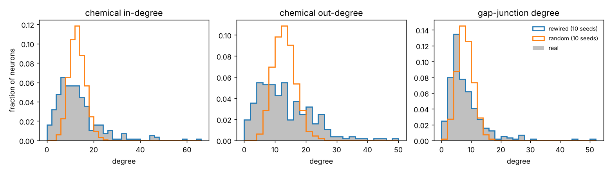
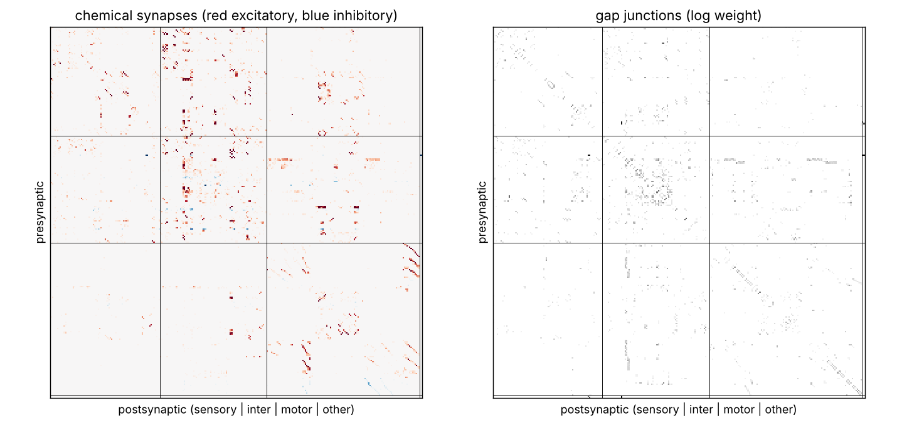

# Graph statistics

Generated by `scripts/graph_stats.py --config configs/connectome.yaml --seeds 10`.
Controls show mean ± SD over seeds. Hops count the shortest path from each sensory
neuron to its nearest motor neuron, chemical synapses forwards, gap junctions both ways.

| statistic | real | rewired | random | sign_shuffled | weight_shuffled |
|---|---|---|---|---|---|
| neurons | 282 | 282 | 282 | 282 | 282 |
| classes | 104 | 104 | 104 | 104 | 104 |
| chem_edges | 3530 | 3530 | 3530 | 3530 | 3530 |
| chem_weight_total | 20225 | 20225 | 20225 | 20225 | 20225 |
| chem_density | 0.0445 | 0.0445 | 0.0445 | 0.0445 | 0.0445 |
| chem_reciprocity | 0.359 | 0.0737 ± 0.0068 | 0.0454 ± 0.0045 | 0.359 | 0.359 |
| excitatory_edges | 3320 | 3320 | 3320 | 3320 | 3320 |
| inhibitory_edges | 210 | 210 | 210 | 210 | 210 |
| silent_edges | 0 | 0 | 0 | 0 | 0 |
| excitatory_weight_fraction | 0.953 | 0.953 | 0.953 | 0.941 ± 0.0037 | 0.94 ± 0.0044 |
| gap_edges | 1057 | 1057 | 1057 | 1057 | 1057 |
| gap_weight_total | 5677 | 5677 | 5677 | 5677 | 5677 |
| gap_max_degree | 50 | 50 | 16.6 ± 1.4 | 50 | 50 |
| max_in_degree | 65 | 65 | 23.9 ± 2.1 | 65 | 65 |
| max_out_degree | 48 | 48 | 24.7 ± 1.1 | 48 | 48 |
| clustering | 0.323 | 0.152 ± 0.0031 | 0.0867 ± 0.0015 | 0.323 | 0.323 |
| largest_scc | 275 | 275 | 282 | 275 | 275 |
| sensory_to_motor_hops_mean | 1.12 | 1.01 ± 0.0081 | 1 | 1.12 | 1.12 |
| sensory_reaching_motor | 83/83 | 83/83 | 83/83 | 83/83 | 83/83 |
| isolated_neurons | 0 | 0 | 0 | 0 | 0 |
| nmj_neurons | 162 | 162 | 162 | 162 | 162 |
| strong_components | 8 | 8 | 1 | 8 | 8 |

## Sign rule per neuron (real graph)

| rule | neurons |
|---|---|
| Acetylcholine | 144 |
| Glutamate | 71 |
| GABA | 31 |
| unknown | 27 |
| Acetylcholine (co-releases Glutamate) | 5 |
| Acetylcholine (co-releases GABA) | 4 |

