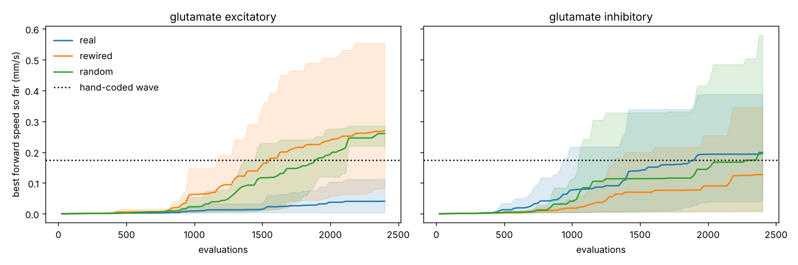

# Locomotion study

Task: crawl forward on a flat field for 30 s; fitness = mean forward speed after 5 s. CMA-ES, population 24, 100 generations, 425 trained parameters in every condition (adaptation on).
Shaded bands in curves.png span the best and worst seed.

| graph | glutamate | seeds | speed mean ± SD (mm/s) | per seed | crawling (> 0.05) | wave direction per seed (+1 head-to-tail) | undulation per seed (Hz) |
|---|---|---|---|---|---|---|---|
| real | excitatory | 3 | 0.041 ± 0.063 | 0.005, 0.113, 0.004 | 1/3 | +0.02, +0.62, -0.03 | 0.08, 0.68, 0.04 |
| rewired | excitatory | 3 | 0.270 ± 0.250 | 0.555, 0.167, 0.087 | 3/3 | +0.83, +0.69, +0.55 | 1.80, 1.04, 0.16 |
| random | excitatory | 3 | 0.260 ± 0.035 | 0.285, 0.220, 0.276 | 3/3 | +0.76, +0.55, +0.67 | 2.32, 0.56, 0.44 |
| real | inhibitory | 3 | 0.197 ± 0.174 | 0.048, 0.154, 0.388 | 2/3 | +0.36, +0.67, +0.87 | 0.20, 0.76, 1.44 |
| rewired | inhibitory | 3 | 0.127 ± 0.190 | 0.029, 0.007, 0.346 | 1/3 | +0.39, +0.05, +0.77 | 0.12, 0.04, 0.88 |
| random | inhibitory | 3 | 0.199 ± 0.330 | 0.009, 0.009, 0.580 | 1/3 | +0.16, +0.01, +0.86 | 0.08, 0.04, 1.48 |

Hand-coded wave for reference: 0.175 mm/s.

