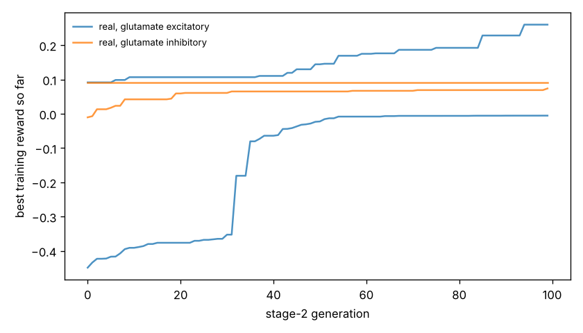

# Chemotaxis results

Test set: 32 fixed starts per arena, never used in training. Reward = mean concentration over the second half minus the start (fraction of peak), minus 0.05 x mean power, minus 0.5 x max(0, 1 - path speed / 0.1 mm/s). 'Concentration gain' leaves out both penalties. 'reached' = ends within 1 mm of the main peak.

## gaussian

| graph | glutamate | seeds | reward per seed | reward mean | concentration gain | reached 1 mm | crawl speed after stage 1 (mm/s) |
|---|---|---|---|---|---|---|---|
| real | excitatory | 2 | -0.006, +0.152 | +0.073 | +0.087 | 19% | 0.03, 0.25 |
| real | inhibitory | 2 | +0.017, +0.036 | +0.026 | +0.041 | 23% | 0.50, 0.29 |
| *blind crawling* | — | — | — | +0.012 | +0.015 | 0% | — |
| *gradient steering* | — | — | — | -0.024 | +0.000 | 0% | — |

## far_start

| graph | glutamate | seeds | reward per seed | reward mean | concentration gain | reached 1 mm | crawl speed after stage 1 (mm/s) |
|---|---|---|---|---|---|---|---|
| real | excitatory | 2 | -0.006, +0.192 | +0.093 | +0.107 | 17% | 0.03, 0.25 |
| real | inhibitory | 2 | -0.003, +0.026 | +0.012 | +0.026 | 31% | 0.50, 0.29 |
| *blind crawling* | — | — | — | +0.002 | +0.004 | 0% | — |
| *gradient steering* | — | — | — | -0.018 | +0.000 | 0% | — |

## two_peaks

| graph | glutamate | seeds | reward per seed | reward mean | concentration gain | reached 1 mm | crawl speed after stage 1 (mm/s) |
|---|---|---|---|---|---|---|---|
| real | excitatory | 2 | -0.006, +0.141 | +0.068 | +0.081 | 16% | 0.03, 0.25 |
| real | inhibitory | 2 | +0.017, +0.032 | +0.024 | +0.039 | 23% | 0.50, 0.29 |
| *blind crawling* | — | — | — | +0.012 | +0.015 | 0% | — |
| *gradient steering* | — | — | — | -0.023 | +0.003 | 3% | — |

## linear

| graph | glutamate | seeds | reward per seed | reward mean | concentration gain | reached 1 mm | crawl speed after stage 1 (mm/s) |
|---|---|---|---|---|---|---|---|
| real | excitatory | 2 | -0.005, +0.319 | +0.157 | +0.170 | nan% | 0.03, 0.25 |
| real | inhibitory | 2 | -0.020, +0.147 | +0.064 | +0.079 | nan% | 0.50, 0.29 |
| *blind crawling* | — | — | — | -0.036 | -0.033 | nan% | — |
| *gradient steering* | — | — | — | +0.203 | +0.208 | nan% | — |

