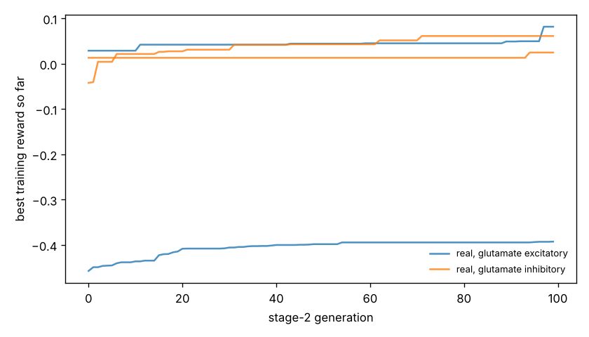

# Chemotaxis results

Test set: 32 fixed starts per arena, never used in training. Reward = mean concentration over the second half minus the start (fraction of peak), minus 0.05 x mean power, minus 0.5 x max(0, 1 - path speed / 0.1 mm/s). 'Concentration gain' leaves out both penalties. 'reached' = ends within 1 mm of the main peak.

## gaussian

| graph | glutamate | seeds | reward per seed | reward mean | concentration gain | reached 1 mm | crawl speed after stage 1 (mm/s) |
|---|---|---|---|---|---|---|---|
| real | excitatory | 2 | -0.393, +0.019 | -0.187 | +0.025 | 2% | 0.03, 0.25 |
| real | inhibitory | 2 | +0.003, +0.003 | +0.003 | +0.019 | 3% | 0.50, 0.29 |
| *blind crawling* | — | — | — | +0.003 | +0.015 | 0% | — |
| *gradient steering* | — | — | — | -0.095 | +0.000 | 0% | — |

## far_start

| graph | glutamate | seeds | reward per seed | reward mean | concentration gain | reached 1 mm | crawl speed after stage 1 (mm/s) |
|---|---|---|---|---|---|---|---|
| real | excitatory | 2 | -0.393, +0.001 | -0.196 | +0.016 | 0% | 0.03, 0.25 |
| real | inhibitory | 2 | -0.013, -0.019 | -0.016 | +0.000 | 0% | 0.50, 0.29 |
| *blind crawling* | — | — | — | -0.007 | +0.004 | 0% | — |
| *gradient steering* | — | — | — | -0.072 | +0.000 | 0% | — |

## two_peaks

| graph | glutamate | seeds | reward per seed | reward mean | concentration gain | reached 1 mm | crawl speed after stage 1 (mm/s) |
|---|---|---|---|---|---|---|---|
| real | excitatory | 2 | -0.393, +0.007 | -0.193 | +0.019 | 0% | 0.03, 0.25 |
| real | inhibitory | 2 | +0.003, +0.004 | +0.003 | +0.019 | 3% | 0.50, 0.29 |
| *blind crawling* | — | — | — | +0.003 | +0.015 | 0% | — |
| *gradient steering* | — | — | — | -0.101 | +0.003 | 3% | — |

## linear

| graph | glutamate | seeds | reward per seed | reward mean | concentration gain | reached 1 mm | crawl speed after stage 1 (mm/s) |
|---|---|---|---|---|---|---|---|
| real | excitatory | 2 | -0.391, -0.166 | -0.279 | -0.067 | nan% | 0.03, 0.25 |
| real | inhibitory | 2 | -0.030, -0.010 | -0.020 | -0.004 | nan% | 0.50, 0.29 |
| *blind crawling* | — | — | — | -0.045 | -0.033 | nan% | — |
| *gradient steering* | — | — | — | +0.185 | +0.208 | nan% | — |

