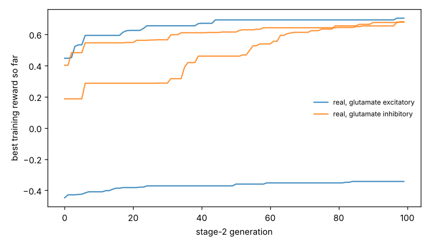

# Chemotaxis results

Test set: 32 fixed starts per arena, never used in training. Reward = mean concentration over the second half minus the start (fraction of peak), minus 0.05 x mean power, minus 0.5 x max(0, 1 - path speed / 0.1 mm/s). 'Concentration gain' leaves out both penalties. 'reached' = ends within 1 mm of the main peak.

## gaussian

| graph | glutamate | seeds | reward per seed | reward mean | concentration gain | reached 1 mm | crawl speed after stage 1 (mm/s) |
|---|---|---|---|---|---|---|---|
| real | excitatory | 2 | -0.388, +0.648 | +0.130 | +0.333 | 28% | 0.03, 0.25 |
| real | inhibitory | 2 | +0.677, +0.637 | +0.657 | +0.688 | 41% | 0.50, 0.29 |
| *blind crawling* | — | — | — | +0.027 | +0.030 | 0% | — |
| *gradient steering* | — | — | — | +0.093 | +0.110 | 0% | — |

## far_start

| graph | glutamate | seeds | reward per seed | reward mean | concentration gain | reached 1 mm | crawl speed after stage 1 (mm/s) |
|---|---|---|---|---|---|---|---|
| real | excitatory | 2 | -0.389, +0.638 | +0.125 | +0.328 | 22% | 0.03, 0.25 |
| real | inhibitory | 2 | +0.635, +0.601 | +0.618 | +0.649 | 31% | 0.50, 0.29 |
| *blind crawling* | — | — | — | +0.021 | +0.024 | 0% | — |
| *gradient steering* | — | — | — | +0.092 | +0.110 | 0% | — |

## two_peaks

| graph | glutamate | seeds | reward per seed | reward mean | concentration gain | reached 1 mm | crawl speed after stage 1 (mm/s) |
|---|---|---|---|---|---|---|---|
| real | excitatory | 2 | -0.390, +0.576 | +0.093 | +0.297 | 19% | 0.03, 0.25 |
| real | inhibitory | 2 | +0.586, +0.543 | +0.565 | +0.596 | 31% | 0.50, 0.29 |
| *blind crawling* | — | — | — | +0.001 | +0.003 | 0% | — |
| *gradient steering* | — | — | — | +0.163 | +0.184 | 9% | — |

## linear

| graph | glutamate | seeds | reward per seed | reward mean | concentration gain | reached 1 mm | crawl speed after stage 1 (mm/s) |
|---|---|---|---|---|---|---|---|
| real | excitatory | 2 | -0.380, +0.768 | +0.194 | +0.397 | nan% | 0.03, 0.25 |
| real | inhibitory | 2 | +0.306, +1.193 | +0.750 | +0.781 | nan% | 0.50, 0.29 |
| *blind crawling* | — | — | — | -0.069 | -0.067 | nan% | — |
| *gradient steering* | — | — | — | +0.451 | +0.455 | nan% | — |

