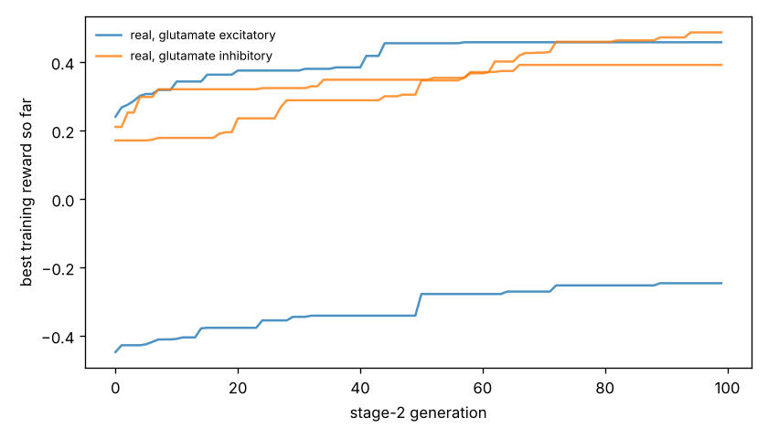

# Chemotaxis results

Test set: 32 fixed starts per arena, never used in training. Reward = mean concentration over the second half minus the start (fraction of peak), minus 0.05 x mean power, minus 0.5 x max(0, 1 - path speed / 0.1 mm/s). 'Concentration gain' leaves out both penalties. 'reached' = ends within 1 mm of the main peak.

## gaussian

| graph | glutamate | seeds | reward per seed | reward mean | concentration gain | reached 1 mm | crawl speed after stage 1 (mm/s) |
|---|---|---|---|---|---|---|---|
| real | excitatory | 2 | -0.388, +0.398 | +0.005 | +0.189 | 16% | 0.03, 0.25 |
| real | inhibitory | 2 | +0.459, +0.341 | +0.400 | +0.429 | 69% | 0.50, 0.29 |
| *blind crawling* | — | — | — | -0.099 | -0.096 | 0% | — |
| *gradient steering* | — | — | — | +0.059 | +0.083 | 0% | — |

## far_start

| graph | glutamate | seeds | reward per seed | reward mean | concentration gain | reached 1 mm | crawl speed after stage 1 (mm/s) |
|---|---|---|---|---|---|---|---|
| real | excitatory | 2 | -0.334, +0.591 | +0.128 | +0.311 | 20% | 0.03, 0.25 |
| real | inhibitory | 2 | +0.678, +0.530 | +0.604 | +0.632 | 77% | 0.50, 0.29 |
| *blind crawling* | — | — | — | +0.021 | +0.024 | 0% | — |
| *gradient steering* | — | — | — | +0.092 | +0.110 | 0% | — |

## two_peaks

| graph | glutamate | seeds | reward per seed | reward mean | concentration gain | reached 1 mm | crawl speed after stage 1 (mm/s) |
|---|---|---|---|---|---|---|---|
| real | excitatory | 2 | -0.382, +0.353 | -0.014 | +0.170 | 9% | 0.03, 0.25 |
| real | inhibitory | 2 | +0.428, +0.317 | +0.373 | +0.401 | 66% | 0.50, 0.29 |
| *blind crawling* | — | — | — | -0.096 | -0.093 | 0% | — |
| *gradient steering* | — | — | — | +0.079 | +0.105 | 3% | — |

## linear

| graph | glutamate | seeds | reward per seed | reward mean | concentration gain | reached 1 mm | crawl speed after stage 1 (mm/s) |
|---|---|---|---|---|---|---|---|
| real | excitatory | 2 | -0.334, +0.156 | -0.089 | +0.095 | nan% | 0.03, 0.25 |
| real | inhibitory | 2 | +0.239, +0.308 | +0.274 | +0.302 | nan% | 0.50, 0.29 |
| *blind crawling* | — | — | — | -0.036 | -0.033 | nan% | — |
| *gradient steering* | — | — | — | +0.203 | +0.208 | nan% | — |

