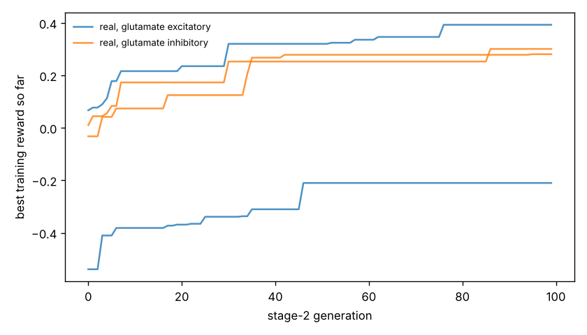

# Chemotaxis results

Test set: 32 fixed starts per arena, never used in training. Reward = mean concentration over the second half minus the start (fraction of peak), minus 0.05 x mean power, minus 0.5 x max(0, 1 - path speed / 0.1 mm/s). 'Concentration gain' leaves out both penalties. 'reached' = ends within 1 mm of the main peak.

## gaussian

| graph | glutamate | seeds | reward per seed | reward mean | concentration gain | reached 1 mm | crawl speed after stage 1 (mm/s) |
|---|---|---|---|---|---|---|---|
| real | excitatory | 2 | -0.360, +0.420 | +0.030 | +0.219 | 22% | 0.03, 0.25 |
| real | inhibitory | 2 | +0.383, +0.344 | +0.364 | +0.394 | 59% | 0.50, 0.29 |
| *blind crawling* | — | — | — | -0.099 | -0.096 | 0% | — |
| *gradient steering* | — | — | — | +0.059 | +0.083 | 0% | — |

## far_start

| graph | glutamate | seeds | reward per seed | reward mean | concentration gain | reached 1 mm | crawl speed after stage 1 (mm/s) |
|---|---|---|---|---|---|---|---|
| real | excitatory | 2 | -0.354, +0.629 | +0.137 | +0.326 | 22% | 0.03, 0.25 |
| real | inhibitory | 2 | +0.560, +0.511 | +0.536 | +0.566 | 55% | 0.50, 0.29 |
| *blind crawling* | — | — | — | +0.021 | +0.024 | 0% | — |
| *gradient steering* | — | — | — | +0.092 | +0.110 | 0% | — |

## two_peaks

| graph | glutamate | seeds | reward per seed | reward mean | concentration gain | reached 1 mm | crawl speed after stage 1 (mm/s) |
|---|---|---|---|---|---|---|---|
| real | excitatory | 2 | -0.359, +0.380 | +0.011 | +0.200 | 23% | 0.03, 0.25 |
| real | inhibitory | 2 | +0.358, +0.315 | +0.336 | +0.367 | 52% | 0.50, 0.29 |
| *blind crawling* | — | — | — | -0.096 | -0.093 | 0% | — |
| *gradient steering* | — | — | — | +0.079 | +0.105 | 3% | — |

## linear

| graph | glutamate | seeds | reward per seed | reward mean | concentration gain | reached 1 mm | crawl speed after stage 1 (mm/s) |
|---|---|---|---|---|---|---|---|
| real | excitatory | 2 | -0.348, +0.232 | -0.058 | +0.131 | nan% | 0.03, 0.25 |
| real | inhibitory | 2 | +0.324, +0.271 | +0.297 | +0.328 | nan% | 0.50, 0.29 |
| *blind crawling* | — | — | — | -0.036 | -0.033 | nan% | — |
| *gradient steering* | — | — | — | +0.203 | +0.208 | nan% | — |

