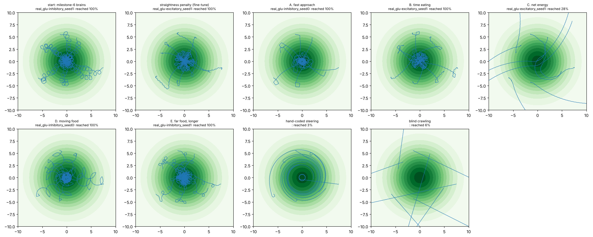

# Natural rewards: which one gives real-worm-like chemotaxis?

Generated by `scripts/compare_natural.py`. Every brain is scored on the same tests, whatever it was trained with: 32 starts 4–8 mm from food, 150 s; a moving-food test (food jumps 5–7 mm at 60 s); and turning on a flat field per mm of progress (a 1 mm circle is 57°/mm; straight is about 0). All runs: the real connectome, fine-tuned from the milestone-6 brains (seeds 0–1, both glutamate settings) for 100 generations.

| scenario | run | reached food | median time to food | time at food | climbed | moving food re-reached | flat-field turning (°/mm) |
|---|---|---|---|---|---|---|---|
| start: milestone-6 brains | real_glu-excitatory_seed0 | 0% | never | 0% | 50% | 0% | 3 |
| start: milestone-6 brains | real_glu-excitatory_seed1 | 97% | 98 s | 20% | 100% | 44% | 19 |
| start: milestone-6 brains | real_glu-inhibitory_seed0 | 100% | 101 s | 26% | 100% | 28% | 498 |
| start: milestone-6 brains | real_glu-inhibitory_seed1 | 100% | 71 s | 33% | 100% | 69% | 190 |
| straightness penalty (fine-tune) | real_glu-excitatory_seed0 | 0% | never | 0% | 50% | 0% | 7 |
| straightness penalty (fine-tune) | real_glu-excitatory_seed1 | 100% | 47 s | 28% | 100% | 94% | 12 |
| straightness penalty (fine-tune) | real_glu-inhibitory_seed0 | 3% | never | 0% | 19% | 3% | 10 |
| straightness penalty (fine-tune) | real_glu-inhibitory_seed1 | 38% | never | 3% | 94% | 25% | 5 |
| A. fast approach | real_glu-excitatory_seed0 | 3% | never | 1% | 34% | 0% | 24 |
| A. fast approach | real_glu-excitatory_seed1 | 100% | 58 s | 17% | 100% | 91% | 15 |
| A. fast approach | real_glu-inhibitory_seed0 | 100% | 44 s | 64% | 100% | 88% | 163 |
| A. fast approach | real_glu-inhibitory_seed1 | 100% | 61 s | 23% | 100% | 75% | 166 |
| B. time eating | real_glu-excitatory_seed0 | 0% | never | 0% | 38% | 0% | 134 |
| B. time eating | real_glu-excitatory_seed1 | 100% | 55 s | 31% | 100% | 56% | 5 |
| B. time eating | real_glu-inhibitory_seed0 | 12% | never | 1% | 31% | 0% | 18 |
| B. time eating | real_glu-inhibitory_seed1 | 100% | 92 s | 26% | 100% | 31% | 230 |
| C. net energy | real_glu-excitatory_seed0 | 0% | never | 0% | 50% | 0% | 9 |
| C. net energy | real_glu-excitatory_seed1 | 28% | never | 2% | 31% | 0% | 23 |
| C. net energy | real_glu-inhibitory_seed0 | 16% | never | 1% | 34% | 0% | 18 |
| C. net energy | real_glu-inhibitory_seed1 | 12% | never | 1% | 59% | 12% | 25 |
| D. moving food | real_glu-excitatory_seed0 | 0% | never | 0% | 50% | 0% | 76 |
| D. moving food | real_glu-excitatory_seed1 | 100% | 50 s | 28% | 100% | 91% | 13 |
| D. moving food | real_glu-inhibitory_seed0 | 100% | 55 s | 52% | 100% | 78% | 82 |
| D. moving food | real_glu-inhibitory_seed1 | 100% | 63 s | 17% | 100% | 56% | 164 |
| E. far food, longer | real_glu-excitatory_seed0 | 0% | never | 0% | 38% | 3% | 30 |
| E. far food, longer | real_glu-excitatory_seed1 | 100% | 47 s | 30% | 100% | 94% | 2 |
| E. far food, longer | real_glu-inhibitory_seed0 | 100% | 58 s | 20% | 100% | 97% | 61 |
| E. far food, longer | real_glu-inhibitory_seed1 | 100% | 47 s | 34% | 100% | 88% | 161 |
| hand-coded steering |  | 3% | never | 2% | 100% | 9% | 0 |
| blind crawling |  | 6% | never | 0% | 9% | 3% | 0 |

## Mean over the four runs of each scenario

| scenario | reached food | time at food | moving food re-reached | flat-field turning (°/mm) |
|---|---|---|---|---|
| start: milestone-6 brains | 74% | 20% | 35% | 177 |
| straightness penalty (fine-tune) | 35% | 8% | 30% | 9 |
| A. fast approach | 76% | 26% | 63% | 92 |
| B. time eating | 53% | 14% | 22% | 97 |
| C. net energy | 14% | 1% | 3% | 19 |
| D. moving food | 75% | 24% | 56% | 84 |
| E. far food, longer | 75% | 21% | 70% | 64 |
| hand-coded steering | 3% | 2% | 9% | 0 |
| blind crawling | 6% | 0% | 3% | 0 |

