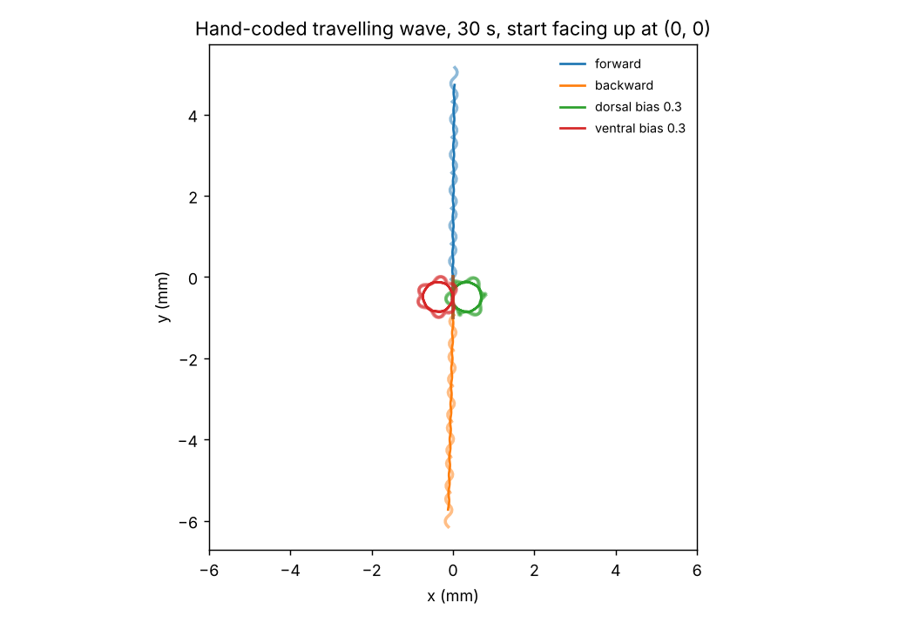
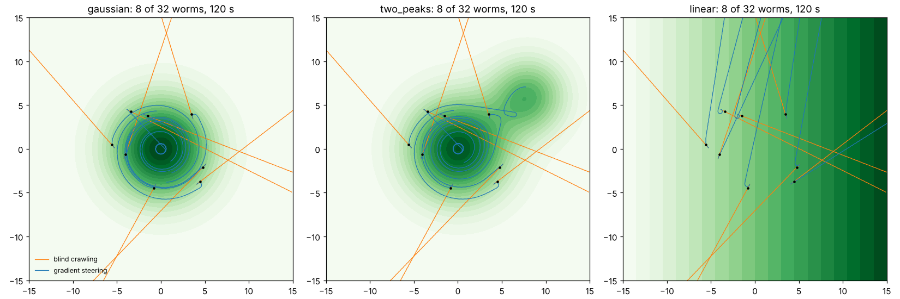

# Body sanity checks (milestone 3)

Generated by `scripts/oscillator_demo.py`. No connectome yet: hand-coded controllers.

## Gaits (after a 5 s start-up)

| controller | path speed (mm/s) | net speed along start heading (mm/s) |
|---|---|---|
| forward | 0.176 | +0.175 |
| backward | 0.176 | -0.175 |
| dorsal bias 0.3 | 0.152 | -0.017 |
| ventral bias 0.3 | 0.152 | -0.017 |

## Chemotaxis baselines (32 worms, seed 0)

Reward: concentration gain (final 10% of the episode minus start), mean ± SD;
divided by peak height for peaked fields, raw for the linear one (slope 0.1/mm).
Gradient steering is a deliberately crude reference (turn while concentration
falls, always the same way); in the linear field it often settles sideways.

| arena | controller | reward | final distance to main peak (mm) |
|---|---|---|---|
| gaussian | blind crawling | -0.451 ± 0.088 | 20.7 |
| gaussian | gradient steering | +0.265 ± 0.094 | 3.2 |
| two_peaks | blind crawling | -0.484 ± 0.091 | 20.7 |
| two_peaks | gradient steering | +0.267 ± 0.102 | 3.7 |
| linear | blind crawling | +0.203 ± 1.551 | n/a |
| linear | gradient steering | +0.469 ± 0.319 | n/a |

