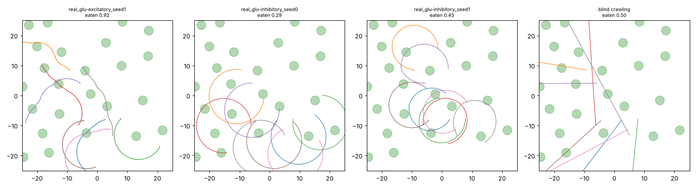

# Patch world, trained from scratch: what the worms do

Reward: food eaten minus 0.2 × energy, 24 food patches, 4-minute lives. Nothing about how to move.
Held-out test layout, 32 starts. (`summary.md` was written by the generic chemotaxis
report: in the patch arena "reward" is food eaten minus energy, and "concentration gain"
is food eaten.)

| run | food eaten | found any food | flat-field turning (°/mm) |
|---|---|---|---|
| excitatory glutamate, seed 0 | 0.00 | 0% | — (froze: its crawler was too weak) |
| excitatory glutamate, seed 1 | **0.85** | 75% | 10 |
| inhibitory glutamate, seed 0 | 0.41 | 41% | 6 |
| inhibitory glutamate, seed 1 | 0.40 | 34% | 6 |
| blind straight crawling | 0.48 | 50% | 0 |
| hand-coded steering | 0.38 | 34% | — |
| *milestone-6 brains (for comparison)* | — | — | 177 on average |

What we learn:

1. **Tight circling is gone.** Turning fell from about 177°/mm (circles about 0.3 mm across) to
   6–10°/mm. The circles are now very wide arcs, about 6–10 mm in radius.
2. **The arcs did not straighten fully, because a 4-minute life can't tell them apart from straight
   lines.** A worm covers about 40 mm in 4 minutes, less than one lap of an arc with an 8 mm radius.
   It never crosses its own path, so straightening further earns nothing.
3. **Why the brains turn in the first place:** on the dorsal side, muscles are driven by
   DA/DB/DD neurons; on the ventral side, by VA/VB/VD. These are different classes with
   independent parameters. Any mismatch is a constant bend, so straight crawling needs the two
   sides to balance exactly. Average dorsal minus ventral muscle activation, mid/tail body:
   milestone-6 brains 0.14–0.29 (tight circles), patch brains 0.04–0.13 (wide arcs),
   except one tail at 0.32.
4. **No worm learned to stop and eat.** Crawling speed on a patch is the same as off it. The
   patch world's eating rate is too fast. A worm passing through a patch's 1 mm eating zone
   is in it for about 13 s, and at 0.1 per second it eats the whole patch on the way through.
   Stopping is worth nothing.
5. **One brain (excitatory, seed 1) really forages.** It eats 1.8× as much as a blind
   straight crawler, and its paths bend towards patches.
