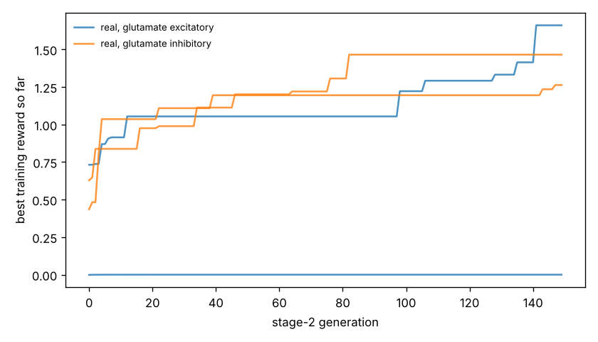

# Chemotaxis results

Test set: 32 fixed starts per arena, never used in training. Reward = mean concentration over the second half minus the start (fraction of peak), minus 0.05 x mean power, minus 0.5 x max(0, 1 - path speed / 0.1 mm/s). 'Concentration gain' leaves out both penalties. 'reached' = ends within 1 mm of the main peak.

## patches

| graph | glutamate | seeds | reward per seed | reward mean | concentration gain | reached 1 mm | crawl speed after stage 1 (mm/s) |
|---|---|---|---|---|---|---|---|
| real | excitatory | 2 | -0.000, +0.764 | +0.382 | +0.424 | nan% | 0.03, 0.25 |
| real | inhibitory | 2 | +0.374, +0.329 | +0.351 | +0.404 | nan% | 0.50, 0.29 |
| *blind crawling* | — | — | — | +0.469 | +0.480 | nan% | — |
| *gradient steering* | — | — | — | +0.228 | +0.381 | nan% | — |

## gaussian

| graph | glutamate | seeds | reward per seed | reward mean | concentration gain | reached 1 mm | crawl speed after stage 1 (mm/s) |
|---|---|---|---|---|---|---|---|
| real | excitatory | 2 | +0.000, -0.031 | -0.015 | -0.003 | 0% | 0.03, 0.25 |
| real | inhibitory | 2 | -0.091, -0.085 | -0.088 | -0.075 | 0% | 0.50, 0.29 |
| *blind crawling* | — | — | — | -0.099 | -0.096 | 0% | — |
| *gradient steering* | — | — | — | +0.059 | +0.083 | 0% | — |

