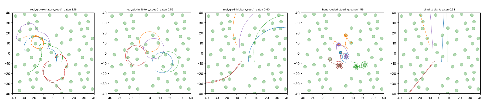

# Patch world v2 + back/belly muscle offset

The world, reward, starting brains (`reports/patches/runs`) and 100 generations are the
same as in [patch world v2](../patches_long/FINDINGS.md). The only change is one extra trained number, an offset added to every dorsal muscle's input and subtracted from every ventral one.
The excitatory seed-0 run was left out: its crawler never moved and it scored 0 in every
patch-world run. Training was restarted once after the container restarted. It now
checkpoints every generation.

## Held-out test: food eaten in 12 minutes (32 starts)

| run | v2 (no change) | offset | offset + tied classes |
|---|---|---|---|
| excitatory glutamate, seed 1 | 2.75 | **3.06** | 0.00 (crawling broke when D/V values were averaged) |
| inhibitory glutamate, seed 0 | 0.59 | 0.44 | 0.43 |
| inhibitory glutamate, seed 1 | 1.98 | 0.65 | **2.39** |
| mean of the three | 1.77 | 1.38 | 0.94 |

For comparison, hand-coded steering scores 1.89 and blind straight crawling 0.77.

## How they move (16 worms, test layout; `scripts/patch_behaviour.py`)

| mover | food eaten (12 min) | speed on food (mm/s) | speed far from food | time on food | turning far from food, °/mm (one-way share) | turning near food, °/mm |
|---|---|---|---|---|---|---|
| real_glu-excitatory_seed1 | 3.16 | 0.094 | 0.123 | 15% | 276 (9%) | 463 |
| real_glu-inhibitory_seed0 | 0.56 | 0.081 | 0.080 | 3% | 27 (21%) | 26 |
| real_glu-inhibitory_seed1 | 0.40 | 0.151 | 0.151 | 2% | 395 (1%) | 389 |
| hand-coded steering | 1.56 | 0.140 | 0.176 | 17% | 28 (59%) | 69 |
| blind straight | 0.53 | 0.176 | 0.176 | 2% | 20 (0%) | 20 |

The one-way share is the useful circling measure. The turning per mm is inflated by
small wiggles in slow, meandering paths, so it is not a circling measure on its own.

What we learn (offset):

1. **The best brain improved.** Excitatory seed 1 eats 3.06 patches, the most of any
   patch-trained brain (v2: 2.75). It meanders between patches and loops on them. Its learned
   offset is small (−0.13).
2. **The other two brains crawl in wide arcs and do not steer.** Inhibitory seed 1 fell from
   1.98 to 0.65: it swapped smell-guided meandering for near-straight blind arcs about 30 mm
   across. Inhibitory seed 0 still circles widely. For both, the offset made the path
   straighter but did not make them steer, and steering is what pays in this world.
3. **Overall:** removing the bend is easy for evolution once the offset exists, as the sweep
   showed. But straightness alone barely pays here; steering by smell does. With three runs,
   the offset is not a reliable improvement in food eaten.
