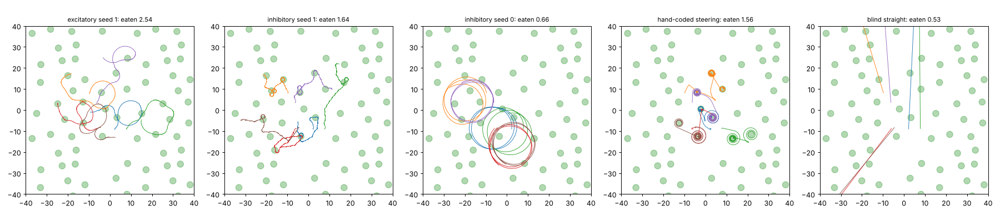

# Patch world v2: wrap-around arena, 12-minute lives, slow eating

Reward: food eaten minus 0.2 × energy, nothing about how to move. Changes from the first
patch world ([../patches/FINDINGS.md](../patches/FINDINGS.md)): the arena wraps around, lives
last 12 minutes instead of 4, and a patch takes about 30 s to eat instead of 10, so
stopping to eat pays. Training started from the first patch-world brains and ran
100 generations. Hand-coded check before training (food minus energy): steering by
smell 1.79, straight crawling 0.63, wide arc 0.32, tight circle about 0.

## Held-out test (32 starts, new layout)

| run | food eaten | found any food | flat-field turning (°/mm) |
|---|---|---|---|
| excitatory glutamate, seed 0 | 0.00 | 0% | — (cannot crawl, from milestone 4) |
| excitatory glutamate, seed 1 | **2.75** | 100% | 8 |
| inhibitory glutamate, seed 0 | 0.59 | 81% | 5 |
| inhibitory glutamate, seed 1 | **1.98** | 97% | 120 |
| hand-coded steering | 1.89 | | |
| blind straight crawling | 0.77 | | |

## How they move (16 worms, 12 min, test layout)

Turning is measured over 2 s windows. The one-way share is how much of the turning goes the
same way: 100% is circling, near 0% is weaving left and right.

| mover | food eaten (12 min) | speed on food (mm/s) | speed far from food | time on food | turning far from food, °/mm (one-way share) | turning near food, °/mm |
|---|---|---|---|---|---|---|
| excitatory seed 1 | 2.54 | 0.090 | 0.105 | 12% | 261 (5%) | 549 |
| inhibitory seed 1 | 1.64 | 0.131 | 0.140 | 12% | 329 (22%) | 322 |
| inhibitory seed 0 | 0.66 | 0.203 | 0.203 | 3% | 26 (20%) | 26 |
| hand-coded steering | 1.56 | 0.140 | 0.176 | 17% | 28 (59%) | 69 |
| blind straight | 0.53 | 0.176 | 0.176 | 2% | 20 (0%) | 20 |

What we learn:

1. **Without circling forced or forbidden, the two best brains stopped circling.** Their
   turning away from food is almost all two-way (one-way share 5% and 22%). The earlier
   circlers were 80–100% one-way. They meander from patch to patch and make small loops
   on food, then leave once it is eaten.
2. **The two best brains out-eat the hand-coded steerer:** 2.75 and 1.98 patches, against
   1.89. They reach food in 97–100% of trials.
3. **The best brain slows down on food,** but only a little (0.090 against 0.105 mm/s).
   No brain learned to stop completely.
4. **Their paths are not straight between patches.** They meander. The hand-coded check said
   straight beats wide arcs, but steering by smell beats both by much more. What
   evolution found is smell-guided meandering, not ballistic runs. Its weaving makes the
   flat-field turning number high for inhibitory seed 1; that number counts weaving as well
   as circling.
5. **One brain (inhibitory, seed 0) still circles widely.** It improved little from where it
   started. It eats about as much as a blind straight crawler.
6. **None of these brains does the old single-food task better than before.** The patch-world
   reward did not train climbing a broad gradient.
