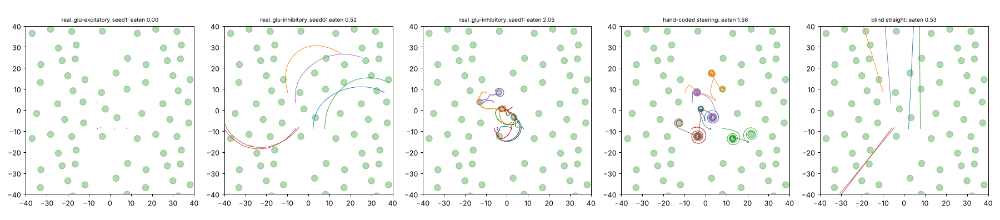

# Patch world v2 + offset + tied dorsal/ventral classes

The world, reward, starting brains (`reports/patches/runs`) and 100 generations are the
same as in [patch world v2](../patches_long/FINDINGS.md). The only change is the offset, plus matching dorsal and ventral motor classes sharing parameters (VA=DA, VB=DB, VD=DD), as in published neuromechanical models; the start brains' D and V values were averaged.
The excitatory seed-0 run was left out: its crawler never moved and it scored 0 in every
patch-world run. Training was restarted once after the container restarted. It now
checkpoints every generation.

## Held-out test: food eaten in 12 minutes (32 starts)

| run | v2 (no change) | offset | offset + tied classes |
|---|---|---|---|
| excitatory glutamate, seed 1 | 2.75 | **3.06** | 0.00 (crawling broke when D/V values were averaged) |
| inhibitory glutamate, seed 0 | 0.59 | 0.44 | 0.43 |
| inhibitory glutamate, seed 1 | 1.98 | 0.65 | **2.39** |
| mean of the three | 1.77 | 1.38 | 0.94 |

For comparison, hand-coded steering scores 1.89 and blind straight crawling 0.77.

## How they move (16 worms, test layout; `scripts/patch_behaviour.py`)

| mover | food eaten (12 min) | speed on food (mm/s) | speed far from food | time on food | turning far from food, °/mm (one-way share) | turning near food, °/mm |
|---|---|---|---|---|---|---|
| real_glu-excitatory_seed1 | 0.00 | nan | 0.000 | 0% | 24678558520 (19%) | 0 |
| real_glu-inhibitory_seed0 | 0.52 | 0.076 | 0.078 | 2% | 357 (1%) | 515 |
| real_glu-inhibitory_seed1 | 2.05 | 0.106 | 0.104 | 10% | 731 (6%) | 695 |
| hand-coded steering | 1.56 | 0.140 | 0.176 | 17% | 28 (59%) | 69 |
| blind straight | 0.53 | 0.176 | 0.176 | 2% | 20 (0%) | 20 |

The one-way share is the useful circling measure. The turning per mm is inflated by
small wiggles in slow, meandering paths, so it is not a circling measure on its own.

What we learn (offset + tied classes):

1. **Tying needs training from the start.** Averaging the dorsal and ventral class values of
   brains trained without tying broke the best crawler (excitatory seed 1 never moved again).
2. **Inhibitory seed 1 improved** (1.98 → 2.39, the best of its seed in any variant). Its
   paths are compact smell-guided meanders with loops on food, without one-way circling
   (6% one-way).
3. **Inhibitory seed 0 crawls in near-straight blind arcs** (0.3°/mm on a flat field: the
   straightest trained brain so far) but rarely steers, so it eats little.
4. As with the offset alone, straight crawling and good foraging did not arrive together.
   The brains that eat well meander and loop at food. The straight ones are blind.
