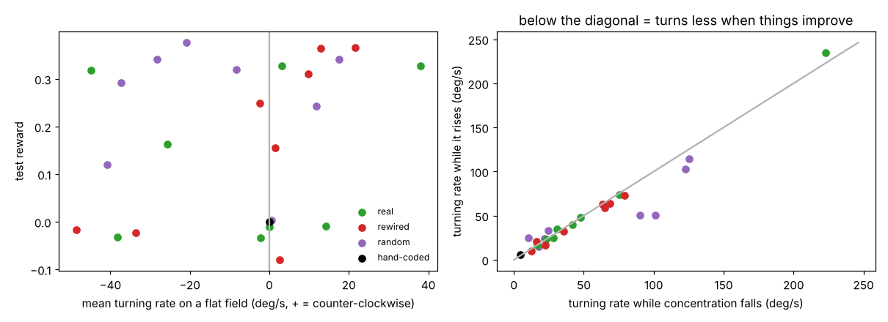

# Why do the trained worms circle?

Generated by `scripts/turning_analysis.py`. Turning rate = rate of change of the centroid's travel direction over 2 s windows (+ = counter-clockwise).

| run | test reward | mean turning on flat field (deg/s) | worms turning the same way | circle radius (mm) | dorsal − ventral muscle activation | turning while rising (deg/s) | turning while falling (deg/s) |
|---|---|---|---|---|---|---|---|
| random_glu-excitatory_seed0 | +0.32 | -8 | 100% | 0.85 | +0.036 | 24 | 22 |
| random_glu-excitatory_seed1 | +0.29 | -37 | 100% | 0.17 | +0.095 | 51 | 90 |
| random_glu-excitatory_seed2 | +0.12 | -41 | 100% | 0.19 | -0.171 | 103 | 123 |
| random_glu-excitatory_seed3 | +0.24 | +12 | 100% | 0.65 | -0.015 | 51 | 101 |
| random_glu-inhibitory_seed0 | +0.38 | -21 | 100% | 0.37 | +0.117 | 24 | 11 |
| random_glu-inhibitory_seed1 | +0.34 | +18 | 100% | 0.90 | -0.068 | 15 | 17 |
| random_glu-inhibitory_seed2 | +0.34 | -28 | 100% | 0.62 | +0.209 | 33 | 24 |
| random_glu-inhibitory_seed3 | +0.00 | +1 | 100% | 10.51 | -0.283 | 114 | 125 |
| real_glu-excitatory_seed0 | -0.01 | +0 | 100% | 405.87 | +0.334 | 234 | 223 |
| real_glu-excitatory_seed1 | +0.33 | +3 | 100% | 3.28 | -0.076 | 23 | 23 |
| real_glu-excitatory_seed2 | -0.03 | -38 | 100% | 0.16 | -0.105 | 74 | 76 |
| real_glu-excitatory_seed3 | -0.03 | -2 | 100% | 2.72 | +0.053 | 48 | 48 |
| real_glu-inhibitory_seed0 | +0.32 | -45 | 100% | 0.26 | +0.250 | 39 | 42 |
| real_glu-inhibitory_seed1 | +0.33 | +38 | 100% | 0.50 | -0.167 | 34 | 31 |
| real_glu-inhibitory_seed2 | +0.16 | -26 | 100% | 0.31 | +0.183 | 25 | 28 |
| real_glu-inhibitory_seed3 | -0.01 | +14 | 100% | 0.44 | -0.181 | 16 | 16 |
| rewired_glu-excitatory_seed0 | -0.08 | +3 | 100% | 1.96 | -0.394 | 73 | 79 |
| rewired_glu-excitatory_seed1 | +0.15 | +1 | 100% | 4.15 | -0.114 | 59 | 65 |
| rewired_glu-excitatory_seed2 | +0.25 | -2 | 100% | 2.98 | +0.284 | 33 | 35 |
| rewired_glu-excitatory_seed3 | -0.02 | -34 | 100% | 0.17 | -0.010 | 63 | 64 |
| rewired_glu-inhibitory_seed0 | +0.31 | +10 | 100% | 1.24 | -0.014 | 10 | 13 |
| rewired_glu-inhibitory_seed1 | -0.02 | -49 | 100% | 0.13 | -0.195 | 63 | 69 |
| rewired_glu-inhibitory_seed2 | +0.36 | +13 | 100% | 0.68 | -0.205 | 21 | 16 |
| rewired_glu-inhibitory_seed3 | +0.37 | +22 | 100% | 0.47 | -0.214 | 16 | 23 |
| hand-coded steering | +0.00 | -0 | 100% | 409.54 | +0.000 | 6 | 4 |

## Where the dorsal−ventral bias comes from (runs with test reward > 0.1)

Mean release of each neuron on the flat field times its dorsal-minus-ventral neuromuscular weight; total and the five largest classes.

| run | total | largest contributions |
|---|---|---|
| random_glu-excitatory_seed0 | -0.072 | VD -0.180, SIB +0.053, SMB +0.035, SMD -0.024, VA -0.023 |
| random_glu-excitatory_seed1 | +0.171 | DD +0.091, DA +0.065, SAB +0.060, SMB -0.056, VB -0.054 |
| random_glu-excitatory_seed2 | -0.078 | VB -0.078, DA +0.066, VA -0.050, SAB -0.040, DB -0.026 |
| random_glu-excitatory_seed3 | -0.000 | AS -0.074, DD +0.059, DA +0.055, VD -0.052, VA -0.046 |
| random_glu-inhibitory_seed0 | +0.067 | VD -0.178, DA -0.131, SMD +0.106, DD +0.090, AS +0.085 |
| random_glu-inhibitory_seed1 | -0.092 | VD -0.155, SMB -0.055, DD +0.054, VB +0.050, SIB +0.046 |
| random_glu-inhibitory_seed2 | +0.119 | VD +0.170, VA -0.100, SMD -0.068, DD -0.062, SMB +0.055 |
| real_glu-excitatory_seed1 | -0.101 | DD +0.151, VA -0.107, SMB -0.056, AS +0.040, VB -0.040 |
| real_glu-inhibitory_seed0 | +0.240 | VD +0.119, AS +0.073, SMD +0.067, DB +0.029, VA +0.029 |
| real_glu-inhibitory_seed1 | -0.081 | VD -0.098, SMD -0.068, SIB -0.046, PDA +0.035, DD +0.032 |
| real_glu-inhibitory_seed2 | +0.134 | VD +0.088, AS +0.079, DA -0.061, VA +0.042, DD +0.040 |
| rewired_glu-excitatory_seed1 | -0.117 | VD +0.083, VB -0.058, VA -0.049, DD -0.041, DB +0.023 |
| rewired_glu-excitatory_seed2 | +0.284 | DA +0.184, DB -0.093, AS +0.083, VA +0.059, SIA +0.046 |
| rewired_glu-inhibitory_seed0 | +0.000 | DD -0.151, VA +0.107, DB -0.047, VD +0.041, DA +0.025 |
| rewired_glu-inhibitory_seed2 | -0.108 | VD -0.113, DA -0.084, AS +0.072, SMB -0.054, SIA +0.042 |
| rewired_glu-inhibitory_seed3 | -0.096 | AS +0.083, SMB +0.073, VD -0.049, DA -0.046, SIA -0.036 |

